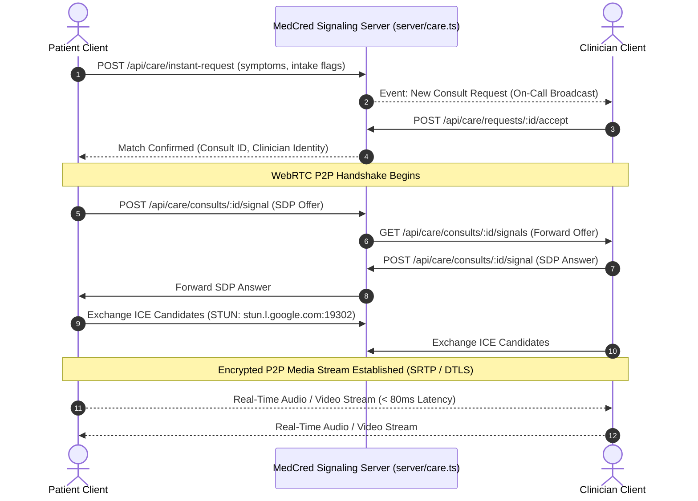

# System Architecture & Technical Specifications

## Platform: MedCred / CareVerified – Verified Doctor & Nurse Network
**Version:** 3.0  
**Status:** Concrete Architectural Baseline  
**Classification:** High-Concurrency Healthcare SaaS / Telemedicine & Credentialing Engine  
**Jurisdiction:** Malaysia (MOH / MMC / LJM / JPDP / Act 586) & MHTC Cross-Border Gateway  

---

## 1. System Topology & Infrastructure Architecture

```
┌────────────────────────────────────────────────────────────────────────────────────────┐
│                                   CLIENT TIERS                                         │
│   Web / Desktop (Chrome/Safari/Edge/Firefox) · Mobile Web (iOS Safari, Android Chrome) │
└───────────────────────────────────────────┬────────────────────────────────────────────┘
                                            │ TLS 1.3 / HTTPS (Port 443)
                                            │ WebRTC Signaling / Audio-Video Media
┌───────────────────────────────────────────▼────────────────────────────────────────────┐
│                             NETWORK & SECURITY PERIMETER                               │
│   Reverse Proxy / Edge Ingress (NGINX / Cloudflare / Node Gateway)                     │
│   - TLS Termination · HTTP/2 Multiplexing · Rate Limiting (express-rate-limit)         │
│   - Helmet.js Security Headers (CSP, HSTS, X-Frame-Options: DENY, Sniff Prevention)     │
└───────────────────────────────────────────┬────────────────────────────────────────────┘
                                            │ Internal Unix Socket / Localhost
┌───────────────────────────────────────────▼────────────────────────────────────────────┐
│                      FULL-STACK APPLICATION RUNTIME (NODE.JS)                          │
│                                                                                        │
│   ┌────────────────────────────────────────────────────────────────────────────────┐   │
│   │                         FRONTEND APPLICATION LAYER (SPA)                       │   │
│   │   React 19 · Vite 6 · Tailwind CSS v4 · Motion · Lucide Icons                 │   │
│   │   - Workspace Router & Identity Context (medi_user / cv_session)               │   │
│   │   - Clinician Split-Screen HUD & Telehealth Media Renderer                     │   │
│   │   - Strict Zero-Border-Radius Design Token Standard (`rounded-none`)           │   │
│   └───────────────────────────────────────┬────────────────────────────────────────┘   │
│                                           │ IPC / REST API / Internal Middleware       │
│   ┌───────────────────────────────────────▼────────────────────────────────────────┐   │
│   │                         CORE BACKEND SERVICE ENGINES                           │   │
│   │   Node.js v22+ · Express 4.x · TypeScript Engine (tsx / esbuild bundle)        │   │
│   │                                                                                │   │
│   │   ├── Auth & Session Gateway (scrypt, HttpOnly Cookies, 15m Lockouts)          │   │
│   │   ├── Telehealth Signaling & Queue Engine (WebRTC Mesh, ICE Handshake)         │   │
│   │   ├── Clinical Charting & SOAP Engine (ICD-10, Poisons Act Verification)       │   │
│   │   ├── Credentialing & SoD Engine (Act 50 s.29, 15m Break-Glass Lease)          │   │
│   │   ├── Pharmacy Dispensing & QR Verification Engine                             │   │
│   │   └── Hospital EHR Webhook Dispatcher (HMAC SHA-256, Exponential Backoff)      │   │
│   └───────────────────────────────────────┬────────────────────────────────────────┘   │
└───────────────────────────────────────────┼────────────────────────────────────────────┘
                                            │ Direct In-Process C-Bindings
┌───────────────────────────────────────────▼────────────────────────────────────────────┐
│                             PERSISTENCE & STORAGE TIER                                 │
│   SQLite 3 Embedded Engine (`node:sqlite` DatabaseSync)                                │
│   - Write-Ahead Logging (`PRAGMA journal_mode = WAL;`)                                 │
│   - Foreign Key Constraint Enforcement (`PRAGMA foreign_keys = ON;`)                   │
│   - Local Isolated Blob Store (`data/uploads/` - Statutory Document Vault)             │
└────────────────────────────────────────────────────────────────────────────────────────┘
```

---

## 2. Frontend Architecture (React 19 SPA)

### 2.1 Workspace & Component Architecture
The frontend is constructed as a high-density, low-latency Single Page Application (SPA) driven by role-scoped workspace routers:

```
src/
├── App.tsx                     # Global Root Router, Session Orchestrator & Role Switcher
├── index.css                   # Tailwind CSS v4 Core, Variables & Zero-Border-Radius Directives
├── types.ts                    # Strict TypeScript Domain Models, Enums & Role Configurations
├── registries.ts               # Council Registry Metadata (MMC, LJM, MDC, Pharmacy Board)
├── identity.ts                 # Malaysian MyKad (NRIC) & International Passport Formatters
├── avatars.tsx                 # Failover Studio Headshots & Identity Avatars
├── locale/                     # Multi-Currency & Locale Formatters (MYR, USD, SGD, IDR, AUD)
└── components/
    ├── DashboardHeader.tsx     # Institutional Banner, Persona Badges & Telemetry Bar
    ├── WorkspaceHeader.tsx     # Standardized Sub-Workspace Typography & Breadcrumb Landscaping
    ├── VerificationTerminal.tsx # Unified Practitioner Workspace (Clinical, Practice, Performance)
    ├── PatientDashboard.tsx    # Patient Care Hub, Health Records Vault & Service Marketplace
    ├── ConsultNow.tsx          # Real-Time Teleconsultation Queue, Intake Triage & Dispatch
    ├── ConsultRoom.tsx         # WebRTC Video Room & Split-Screen Clinician HUD
    ├── ClinicalWorkspace.tsx   # SOAP Charting, Poisons Act Rx Guardrails & MMC MC Policies
    ├── AdminDashboard.tsx      # Regulatory Admin Suite, Four-Eyes Disciplinary & SoD Matrix
    ├── AdminTrustPanel.tsx     # Licence Expiry Watchlist & Complaint Resolution
    ├── SanctionsDrawer.tsx     # Structured Act 50 / Act 180 Disciplinary Order Drawer
    ├── AdminAuditLog.tsx       # SQLite WAL Compliance Audit Log Query Interface
    ├── FacilityWorkspace.tsx   # Act 586 Hospital Staffing Hub & Locum Shift Management
    └── PharmacyWorkspace.tsx   # Community Pharmacy Dispensing & Digital Rx Verification
```

### 2.2 Design Token Standards (Zero-Border-Radius Directive)
In accordance with enterprise institutional clinical software ergonomics, the user interface enforces a strict geometric rule:
* **Border Radii:** Hard-coded to `rounded-none` across all interactive elements (buttons, inputs, cards, dialogs, drawers, badges).
* **Typography:** Systematic font hierarchy utilizing system sans-serif font stacks paired with tabular monospaced numerics (`tabular-nums font-mono`) for timestamps, license IDs, and vital telemetry.
* **Accessibility Compliance:** WCAG 2.1/2.2 AA compliant focus rings (`focus:outline-none focus:border-[color:var(--t-600)]`), explicit `aria-pressed` states on media toggles, and semantic role landmarks (`role="tablist"`, `role="tabpanel"`).

---

## 3. Full-Stack Backend Architecture

### 3.1 Server Pipeline & Middleware Topology
The Express server (`server.ts`) initializes an audited, idempotent middleware pipeline executed in the following order:

```
Incoming Request
       │
       ▼
1. Security Headers (Helmet.js)
       │ - Sets Content-Security-Policy, Strict-Transport-Security, X-Frame-Options: DENY
       ▼
2. Rate Limiting (express-rate-limit)
       │ - Global window: 15 minutes, burst allowances tuned per route type
       │ - Specialized auth limiters: 30 attempts / 15 mins for `/api/auth/login`
       ▼
3. Body Parsers & JSON Decoders
       │ - `express.json({ limit: '2mb' })`
       │ - `express.urlencoded({ extended: false })`
       ▼
4. Cookie & Session Extraction (`loadSession` middleware)
       │ - Extracts `cv_session` token from HttpOnly cookie
       │ - Computes SHA-256 hash of token and queries `sessions` table
       │ - Verifies revocation status and `sessions_valid_after` barrier
       │ - Attaches authenticated `req.user` payload
       ▼
5. Route Handlers & Statutory RBAC Guards
       │ - `requireAuth`: Enforces valid authentication
       │ - `requireRole('admin')`: Enforces institutional role membership
       ▼
6. SQLite WAL Mutation & Audit Logging
       │ - Executes prepared SQL statements in transactions
       │ - Writes immutable entry to `audit_log` table
       ▼
Response Dispatched
```

---

## 4. Real-Time Teleconsultation & Media Protocol

### 4.1 Signaling & WebRTC Mesh Architecture
Virtual consultations utilize a Peer-to-Peer (P2P) WebRTC connection mediated by server-side signaling endpoints (`server/care.ts`):



### 4.2 Clinician Split-Screen Heads-Up Display (HUD)
Within `ConsultRoom.tsx`, the interface mounts a synchronous split-screen view:
* **Left Viewport (50% Desktop Width):** Video media element, participant badge, microphone/camera controls, connection stability indicator, and in-call messaging drawer.
* **Right Viewport (50% Desktop Width):** Embedded [`ClinicalWorkspace.tsx`](file:///c:/Users/Manas/.gemini/antigravity/scratch/careverified---verified-doctor---nurse-network/src/components/ClinicalWorkspace.tsx) executing active SOAP encounter notes, e-prescribing with real-time Poisons Act safety checking, and instant lab orders without losing visual contact with the patient.

---

## 5. Persistence Architecture & Database Schema

### 5.1 SQLite Configuration & Integrity
The database utilizes Node.js v22's native C-binding `node:sqlite` (`DatabaseSync`):
```sql
PRAGMA journal_mode = WAL;
PRAGMA synchronous = NORMAL;
PRAGMA foreign_keys = ON;
PRAGMA busy_timeout = 5000;
```
* **WAL (Write-Ahead Logging):** Enables concurrent readers while writes execute, eliminating locking bottlenecks.
* **Foreign Keys:** Enforces referential integrity on cascades across users, sessions, documents, and clinical records.

### 5.2 Core Schema Definitions

#### Users & Sessions
```sql
CREATE TABLE IF NOT EXISTS users (
  id TEXT PRIMARY KEY,
  email TEXT NOT NULL UNIQUE COLLATE NOCASE,
  password_hash TEXT NOT NULL,
  role TEXT NOT NULL CHECK (role IN ('patient','practitioner','admin','pharmacy','facility')),
  name TEXT NOT NULL,
  avatar_url TEXT,
  profile_id TEXT,
  facility_id TEXT,
  status TEXT NOT NULL DEFAULT 'active',
  failed_logins INTEGER DEFAULT 0,
  locked_until TEXT,
  sessions_valid_after TEXT,
  created_at TEXT NOT NULL
);

CREATE TABLE IF NOT EXISTS sessions (
  token_hash TEXT PRIMARY KEY,
  user_id TEXT NOT NULL REFERENCES users(id) ON DELETE CASCADE,
  created_at TEXT NOT NULL,
  expires_at TEXT NOT NULL
);
CREATE INDEX IF NOT EXISTS idx_sessions_user ON sessions(user_id);
```

#### Credentialing, Disciplinary Sanctions & Segregation of Duties
```sql
CREATE TABLE IF NOT EXISTS verification_requests (
  id TEXT PRIMARY KEY,
  user_id TEXT NOT NULL,
  status TEXT NOT NULL CHECK (status IN ('Pending','Verified','Rejected','Info Requested')),
  reviewed_by TEXT REFERENCES users(id),
  reviewed_at TEXT,
  rejection_reason TEXT,
  registry_reference TEXT,
  created_at TEXT NOT NULL
);

CREATE TABLE IF NOT EXISTS disciplinary_sanctions (
  id TEXT PRIMARY KEY,
  professional_id TEXT NOT NULL,
  initiator_id TEXT NOT NULL REFERENCES users(id),
  initiator_name TEXT NOT NULL,
  initiator_role TEXT NOT NULL,
  countersigner_id TEXT REFERENCES users(id),
  countersigner_name TEXT,
  countersigner_role TEXT,
  sanction_type TEXT NOT NULL,
  statutory_basis TEXT NOT NULL,
  reason TEXT NOT NULL,
  reference_no TEXT,
  status TEXT NOT NULL DEFAULT 'pending_countersign' CHECK (status IN ('pending_countersign','active','dismissed')),
  effective_from TEXT NOT NULL,
  countersigned_at TEXT,
  created_at TEXT NOT NULL
);
CREATE INDEX IF NOT EXISTS idx_sanctions_prof ON disciplinary_sanctions(professional_id);
CREATE INDEX IF NOT EXISTS idx_sanctions_status ON disciplinary_sanctions(status);
```

#### Hospital EHR Webhook Dispatch Engine
```sql
CREATE TABLE IF NOT EXISTS hospital_webhooks (
  id TEXT PRIMARY KEY,
  facility_name TEXT NOT NULL,
  endpoint_url TEXT NOT NULL,
  event_types TEXT NOT NULL,
  secret_key TEXT NOT NULL DEFAULT 'whsec_medcred_statutory_kpj_pantai_live_2026',
  active INTEGER NOT NULL DEFAULT 1,
  created_at TEXT NOT NULL
);

CREATE TABLE IF NOT EXISTS webhook_dispatch_logs (
  id TEXT PRIMARY KEY,
  webhook_id TEXT NOT NULL REFERENCES hospital_webhooks(id) ON DELETE CASCADE,
  facility_name TEXT NOT NULL,
  endpoint_url TEXT NOT NULL,
  event_type TEXT NOT NULL,
  payload TEXT NOT NULL,
  status TEXT NOT NULL CHECK (status IN ('dispatching','delivered','retry_scheduled','failed')),
  response_code INTEGER,
  attempt_count INTEGER DEFAULT 1,
  max_retries INTEGER DEFAULT 3,
  last_error TEXT,
  next_retry_at TEXT,
  created_at TEXT NOT NULL
);
CREATE INDEX IF NOT EXISTS idx_webhook_status ON webhook_dispatch_logs(status, next_retry_at);
```

#### Immutable Statutory Audit Trail
```sql
CREATE TABLE IF NOT EXISTS audit_log (
  id INTEGER PRIMARY KEY AUTOINCREMENT,
  ts TEXT NOT NULL,
  actor_id TEXT,
  actor_role TEXT,
  action TEXT NOT NULL,
  target_type TEXT,
  target_id TEXT,
  ip TEXT,
  details TEXT
);
CREATE INDEX IF NOT EXISTS idx_audit_action ON audit_log(action);
CREATE INDEX IF NOT EXISTS idx_audit_target ON audit_log(target_type, target_id);
```

---

## 6. Statutory Governance & Segregation of Duties (SoD) Engine

### 6.1 Four-Eyes Principle Enforcement (Medical Act 1971 Section 29)
The platform prevents unilateral administrative action for high-impact clinical sanctions:
1. **Initiation (`/api/professionals/:id/sanction/initiate`):** An authorized registrar submits a sanction proposal citing statutory grounds (e.g. Act 50 Section 29 or Act 180 Section 16). The order enters `pending_countersign` state.
2. **Four-Eyes Validation Barrier:** The API blocks the initiating officer from countersigning their own order:
   ```ts
   if (actor.id === sanction.initiator_id && countersignerRole !== "super_admin") {
     return fail(res, 403, "Four-Eyes Principle Violation: Countersignature must be performed by a distinct authorized administrative officer or super_admin.");
   }
   ```
3. **Countersignature & Syndication (`/api/admin/sanctions/:id/countersign`):** Upon confirmation by a second officer or plenary authority, the practitioner is marked `Suspended`, delisted from search, and outbound webhooks fire.

### 6.2 Break-Glass Ephemeral Lease Protocol
Privilege elevation into plenary administration (`super_admin`) is time-bounded:
* **Lease Duration:** Capped at exactly **15 minutes (900 seconds)**.
* **Audit Recording:** Elevation requires logging an emergency case reference and substantive statutory rationale (`POST /api/admin/subrole/elevation`).
* **Active Lease Tracking:** The frontend tracks the lease countdown via `localStorage.getItem('cv_admin_elevation_lease_until')` and an active 1-second interval.
* **Auto-Reversion Daemon:** Upon expiration, the client clears elevated keys, reverts the subrole to `registrar`, dispatches global role-change events, and enforces lower privilege bounds.

---

## 7. Interoperability & Integration Architecture

### 7.1 Outbound Hospital EHR Webhook Dispatcher
When clinical credentialing status changes, MedCred notifies subscribed hospital EHR systems (Pantai Hospital KL, KPJ Healthcare, Gleneagles Hospital):

* **Payload Cryptographic Signature:**
  ```ts
  const signature = crypto.createHmac("sha256", secretKey).update(payloadString).digest("hex");
  ```
* **HTTP Header Specifications:**
  * `X-MedCred-Signature`: `sha256=${signature}` (Standard GitHub/Stripe HMAC format).
  * `X-MedCred-Signature-256`: `sha256=${signature}` (Enterprise header format).
  * `X-MedCred-Timestamp`: Unix epoch integer (`Math.floor(Date.now() / 1000)`). Receivers reject timestamps drifting > 300 seconds.
  * `X-MedCred-Delivery-Id`: Unique delivery UUID (`whl-...`) matching WAL dispatch log.
  * `X-MedCred-Event`: Event topic (e.g., `practitioner.verified`, `practitioner.suspended`).
  * `X-MedCred-Delivery-Attempt`: Current delivery attempt number (`1..3`).
* **Fault Tolerance & Exponential Backoff:**
  * Attempt 1: Immediate dispatch (3.5-second timeout).
  * Failover Attempt 2: Scheduled at `T + 60s`.
  * Failover Attempt 3: Scheduled at `T + 300s` (5 minutes).
  * Final Failover: Marked `failed` at `T + 1800s` (30 minutes) and escalated to admin queue.

---

## 8. Security, Cryptography & Data Sovereignty (PDPA 2010)

| Security Domain | Architectural Mechanism | Standard / Law |
| :--- | :--- | :--- |
| **Password Derivation** | `scryptSync(password, salt, 64, { N: 16384, r: 8, p: 1 })` | OWASP / NIST SP 800-63B |
| **Session Security** | SHA-256 token hashing; stored in HttpOnly, SameSite=Lax cookie | RFC 6265bis |
| **Account Defense** | 15-minute lock after 5 consecutive failures; constant-time dummy hash verification | CIS Benchmarks |
| **Clinical Grant Lifetime** | Hard SQL barrier expiring temporary doctor access after 30 days (`WHERE expires_at > datetime('now')`) | PDPA 2010 Section 30 |
| **Data Sovereignty** | Isolated local storage (`data/careverified.db`); cross-border Section 129 transfer register | PDPA 2010 Section 129 |
| **Breach Governance** | Append-only security incident table with 72-hour Commissioner reporting countdown | JPDP Data Breach Guidelines |

---

## 9. Build, Test & Deployment Verification Pipeline

```bash
# Production Bundle & Server Compilation
npm run build
# 1. Vite transforms client SPA -> dist/
# 2. Esbuild compiles server.ts & modules -> dist/server.cjs (CJS bundle)

# Production Startup
npm start
# node dist/server.cjs (Listens on http://0.0.0.0:3000)

# Development Runtime
npm run dev
# tsx server.ts (Hot-reload development server with embedded Vite middleware)
```
