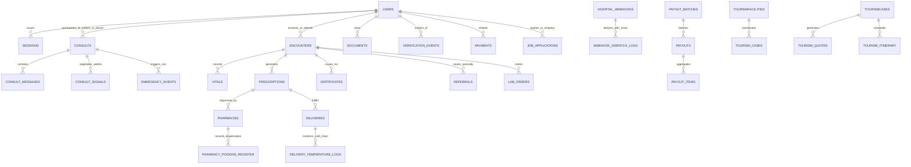

# CareVerified Relational Database Specification (DATABASE.md)

This document provides the definitive architectural specification, Entity-Relationship mapping, DDL schema reference, indexing blueprint, and statutory data retention manual for the **CareVerified (MedCred)** enterprise digital health platform.

---

## 1. Executive Summary & Engine Architecture

CareVerified utilizes an embedded, zero-network-overhead relational storage engine powered by Node.js 22+ native SQLite bindings (`node:sqlite` via `DatabaseSync`). The database executes in a high-concurrency, multi-tenant environment serving clinicians, patients, healthcare institutions, pharmacies, and administrative governance officers.

### Engine Configuration & PRAGMA Settings

To support low-latency WebRTC signaling, real-time vital telemetry, concurrent e-prescription state machines, and high-frequency audit streaming, the SQLite engine is initialized with the following PRAGMAs on every connection boot (`server/db.ts`):

```sql
-- Enable Write-Ahead Logging for non-blocking concurrent readers and writers
PRAGMA journal_mode = WAL;

-- Enforce strict relational referential integrity across all foreign keys
PRAGMA foreign_keys = ON;

-- Optimize disk fsync flushes: WAL ensures database durability with minimal I/O stalls
PRAGMA synchronous = NORMAL;

-- Set lock acquisition retry window to prevent SQLITE_BUSY under burst traffic
PRAGMA busy_timeout = 5000;
```

### Architectural Principles
1. **Statutory & Regulatory Alignment**: Designed to comply strictly with the Malaysian Telemedicine Act 1997, Medical Act 1971, Poisons Act 1952, Digital Signature Act 1997, and Personal Data Protection Act 2010 (PDPA).
2. **Segregation of Duties (SoD)**: Hard schema constraints enforce dual-authorization protocols (e.g. `disciplinary_sanctions` requires both an initiator and countersigner; `users` role hierarchy separates administrative functions from clinical diagnosis).
3. **Immutability & Provenance**: Audit trails (`audit_log`, `verification_events`, `erasure_log`, `pharmacy_poisons_register`) operate as append-only registries with SHA-256 tamper-evident digests.
4. **Time-Bounded Access**: Clinical record grants (`record_grants`) enforce a statutory hard ceiling of 30 days maximum validity, preventing indefinite ambient access to electronic health records.
5. **Unified Multi-Tenancy**: Data partitioning via `facility_id`, `practitioner_id`, and `patient_id` ensures rigorous isolation across clinical networks and institutional tenants.

---

## 2. High-Level Entity-Relationship Model (ERD)



---
## 1. Identity, Authentication & Granular Access Control

### Table: users

```sql
CREATE TABLE "users" (
  id TEXT PRIMARY KEY,
  email TEXT NOT NULL UNIQUE COLLATE NOCASE,
  password_hash TEXT NOT NULL,
  role TEXT NOT NULL CHECK (role IN ('patient','practitioner','admin','pharmacy','facility')),
  name TEXT NOT NULL,
  avatar_url TEXT,
  profile_id TEXT,
  status TEXT NOT NULL DEFAULT 'active',
  consent_version TEXT,
  consent_at TEXT,
  failed_logins INTEGER NOT NULL DEFAULT 0,
  locked_until TEXT,
  deletion_requested_at TEXT,
  created_at TEXT NOT NULL
, must_change_password INTEGER NOT NULL DEFAULT 0, totp_secret TEXT, totp_enabled INTEGER NOT NULL DEFAULT 0, pharmacy_owner INTEGER NOT NULL DEFAULT 0, sessions_valid_after TEXT, lang TEXT, facility_id TEXT)
```

### Table: sessions

```sql
CREATE TABLE sessions (
  token_hash TEXT PRIMARY KEY,
  user_id TEXT NOT NULL REFERENCES users(id) ON DELETE CASCADE,
  created_at TEXT NOT NULL,
  expires_at TEXT NOT NULL,
  ip TEXT,
  user_agent TEXT
)
```

### Table: password_resets

```sql
CREATE TABLE password_resets (
  token_hash TEXT PRIMARY KEY, user_id TEXT NOT NULL, created_at TEXT NOT NULL, expires_at TEXT NOT NULL, used_at TEXT
)
```

### Table: documents

```sql
CREATE TABLE documents (
  id TEXT PRIMARY KEY,
  owner_id TEXT NOT NULL REFERENCES users(id) ON DELETE CASCADE,
  kind TEXT NOT NULL,
  original_name TEXT NOT NULL,
  mime TEXT NOT NULL,
  size INTEGER NOT NULL,
  stored_name TEXT NOT NULL,
  sha256 TEXT NOT NULL,
  verification_request_id TEXT,
  created_at TEXT NOT NULL
)
```

### Table: records

```sql
CREATE TABLE records (
  collection TEXT NOT NULL,
  id TEXT NOT NULL,
  data TEXT NOT NULL,
  PRIMARY KEY (collection, id)
)
```

## 2. Telehealth Operations, Real-Time Presence & Roster Scheduling

### Table: presence

```sql
CREATE TABLE presence (
  profile_id TEXT PRIMARY KEY,
  online INTEGER NOT NULL DEFAULT 0,
  last_seen TEXT NOT NULL
)
```

### Table: roster

```sql
CREATE TABLE roster (
  profile_id TEXT NOT NULL,
  day INTEGER NOT NULL,
  hour INTEGER NOT NULL,
  PRIMARY KEY (profile_id, day, hour)
)
```

### Table: consults

```sql
CREATE TABLE consults (
  id TEXT PRIMARY KEY,
  patient_user_id TEXT NOT NULL,
  professional_id TEXT,
  status TEXT NOT NULL,
  mode TEXT NOT NULL,
  symptoms TEXT NOT NULL,
  red_flags TEXT,
  fee_sen INTEGER NOT NULL,
  created_at TEXT NOT NULL,
  queued_at TEXT,
  escalated_at TEXT,
  accepted_at TEXT,
  ended_at TEXT,
  end_reason TEXT
, share_record INTEGER NOT NULL DEFAULT 0, patient_country TEXT NOT NULL DEFAULT 'MY', first_visit INTEGER NOT NULL DEFAULT 0, chronic_condition INTEGER NOT NULL DEFAULT 0, cross_border_ack INTEGER NOT NULL DEFAULT 0)
```

### Table: consult_declines

```sql
CREATE TABLE consult_declines (
  consult_id TEXT NOT NULL,
  professional_id TEXT NOT NULL,
  PRIMARY KEY (consult_id, professional_id)
)
```

### Table: consult_messages

```sql
CREATE TABLE consult_messages (
  id INTEGER PRIMARY KEY AUTOINCREMENT,
  consult_id TEXT NOT NULL,
  sender_user_id TEXT NOT NULL,
  text TEXT NOT NULL,
  ts TEXT NOT NULL
)
```

### Table: consult_signals

```sql
CREATE TABLE consult_signals (
  id INTEGER PRIMARY KEY AUTOINCREMENT,
  consult_id TEXT NOT NULL,
  from_user_id TEXT NOT NULL,
  kind TEXT NOT NULL,
  payload TEXT NOT NULL,
  ts TEXT NOT NULL
)
```

### Table: emergency_events

```sql
CREATE TABLE emergency_events (
  id TEXT PRIMARY KEY,
  user_id TEXT NOT NULL,
  ts TEXT NOT NULL,
  lat REAL,
  lng REAL,
  note TEXT,
  status TEXT NOT NULL DEFAULT 'open',
  handled_by TEXT,
  handled_at TEXT
)
```

## 3. Clinical EHR, Consultations, Vitals & Regulatory Orders

### Table: encounters

```sql
CREATE TABLE encounters (
  id TEXT PRIMARY KEY, kind TEXT NOT NULL, ref_id TEXT NOT NULL, patient_user_id TEXT NOT NULL, professional_id TEXT NOT NULL,
  subjective TEXT, objective TEXT, assessment TEXT, plan TEXT, created_at TEXT NOT NULL, updated_at TEXT NOT NULL, signed_at TEXT,
  UNIQUE (kind, ref_id)
)
```

### Table: vitals

```sql
CREATE TABLE vitals (
  id TEXT PRIMARY KEY, user_id TEXT NOT NULL, ts TEXT NOT NULL, kind TEXT NOT NULL,
  value1 REAL NOT NULL, value2 REAL, unit TEXT NOT NULL, note TEXT
)
```

### Table: health_items

```sql
CREATE TABLE health_items (
  id TEXT PRIMARY KEY, user_id TEXT NOT NULL, type TEXT NOT NULL, name TEXT NOT NULL, detail TEXT,
  severity TEXT, active INTEGER NOT NULL DEFAULT 1, created_at TEXT NOT NULL, updated_at TEXT NOT NULL
)
```

### Table: record_grants

```sql
CREATE TABLE record_grants (
  id TEXT PRIMARY KEY, patient_user_id TEXT NOT NULL, professional_id TEXT NOT NULL, source TEXT NOT NULL,
  ref_id TEXT, granted_at TEXT NOT NULL, expires_at TEXT NOT NULL, revoked_at TEXT
)
```

### Table: certificates

```sql
CREATE TABLE certificates (
  id TEXT PRIMARY KEY, code TEXT NOT NULL UNIQUE, patient_user_id TEXT NOT NULL, professional_id TEXT NOT NULL,
  from_date TEXT NOT NULL, to_date TEXT NOT NULL, remarks TEXT, issued_at TEXT NOT NULL, signature TEXT NOT NULL
)
```

### Table: referrals

```sql
CREATE TABLE referrals (
  id TEXT PRIMARY KEY, patient_user_id TEXT NOT NULL, from_professional_id TEXT NOT NULL, to_specialty TEXT NOT NULL,
  to_professional_id TEXT, reason TEXT NOT NULL, urgency TEXT NOT NULL, issued_at TEXT NOT NULL
)
```

### Table: lab_orders

```sql
CREATE TABLE lab_orders (
  id TEXT PRIMARY KEY, patient_user_id TEXT NOT NULL, professional_id TEXT NOT NULL, tests TEXT NOT NULL, notes TEXT,
  status TEXT NOT NULL DEFAULT 'ordered', ordered_at TEXT NOT NULL, result_document_id TEXT, resulted_at TEXT
)
```

## 4. Pharmacy, E-Prescribing, Controlled Drugs & Cold-Chain Logistics

### Table: prescriptions

```sql
CREATE TABLE prescriptions (
  id TEXT PRIMARY KEY, code TEXT NOT NULL UNIQUE, patient_user_id TEXT NOT NULL, professional_id TEXT NOT NULL,
  kind TEXT NOT NULL, ref_id TEXT NOT NULL, items TEXT NOT NULL, diagnosis TEXT NOT NULL, notes TEXT,
  issued_at TEXT NOT NULL, valid_until TEXT NOT NULL, status TEXT NOT NULL DEFAULT 'active',
  pharmacy_id TEXT, dispensed_at TEXT, dispensed_by TEXT, cancelled_reason TEXT, signature TEXT NOT NULL,
  warnings TEXT, record_checked INTEGER NOT NULL DEFAULT 0
, sent_at TEXT, fill_status TEXT, fill_reason TEXT, fill_updated_at TEXT, first_response_at TEXT, share_safety INTEGER NOT NULL DEFAULT 0, insurance_policy_id TEXT, gl_status TEXT, gl_number TEXT, gl_note TEXT, dispensing_pharmacist TEXT, poisons_entry_no TEXT)
```

### Table: pharmacies

```sql
CREATE TABLE pharmacies (
  id TEXT PRIMARY KEY, name TEXT NOT NULL, address TEXT NOT NULL, phone TEXT, pin_hash TEXT NOT NULL,
  active INTEGER NOT NULL DEFAULT 1, created_at TEXT NOT NULL
, city TEXT, hours TEXT, services TEXT, licence_no TEXT, pharmacist_name TEXT, pharmacist_reg TEXT, verified_at TEXT, verified_by TEXT, licence_expiry TEXT, pharmacist_apc_expiry TEXT, licence_type TEXT, registry_reference TEXT, delivery_methods TEXT, cold_chain INTEGER NOT NULL DEFAULT 0, panel_insurers TEXT)
```

### Table: pharmacy_events

```sql
CREATE TABLE pharmacy_events (
  id INTEGER PRIMARY KEY AUTOINCREMENT, pharmacy_id TEXT NOT NULL, prescription_id TEXT, ts TEXT NOT NULL,
  actor_user_id TEXT, type TEXT NOT NULL, detail TEXT
)
```

### Table: pharmacy_notes

```sql
CREATE TABLE pharmacy_notes (
  pharmacy_id TEXT NOT NULL, prescription_id TEXT NOT NULL, note TEXT NOT NULL, updated_at TEXT NOT NULL,
  PRIMARY KEY (pharmacy_id, prescription_id)
)
```

### Table: pharmacy_poisons_register

```sql
CREATE TABLE pharmacy_poisons_register (
      id INTEGER PRIMARY KEY AUTOINCREMENT,
      pharmacy_id TEXT NOT NULL,
      prescription_id TEXT NOT NULL,
      entry_serial_no TEXT NOT NULL,
      year INTEGER NOT NULL,
      sequence_no INTEGER NOT NULL,
      pharmacist_name TEXT NOT NULL,
      dispensed_at TEXT NOT NULL,
      created_at TEXT NOT NULL,
      UNIQUE(pharmacy_id, year, sequence_no),
      UNIQUE(pharmacy_id, prescription_id)
    )
```

### Table: deliveries

```sql
CREATE TABLE deliveries (
  id TEXT PRIMARY KEY, prescription_id TEXT NOT NULL, pharmacy_id TEXT NOT NULL, patient_user_id TEXT NOT NULL,
  method TEXT NOT NULL, status TEXT NOT NULL DEFAULT 'requested', address TEXT NOT NULL, contact_phone TEXT,
  partner_ref TEXT, tracking_url TEXT, fee_sen INTEGER, cold_chain INTEGER NOT NULL DEFAULT 0, temperature_note TEXT,
  requested_at TEXT NOT NULL, updated_at TEXT NOT NULL, delivered_at TEXT, recipient_name TEXT, failure_reason TEXT
)
```

### Table: delivery_temperature_logs

```sql
CREATE TABLE delivery_temperature_logs (
  id TEXT PRIMARY KEY,
  delivery_id TEXT NOT NULL,
  temperature_celsius REAL NOT NULL,
  checkpoint TEXT NOT NULL,
  excursion_flag INTEGER NOT NULL DEFAULT 0,
  note TEXT,
  recorded_at TEXT NOT NULL,
  recorded_by_user_id TEXT
)
```

## 5. Credentialing, Governance, Disciplinary & Hospital Webhooks

### Table: verification_events

```sql
CREATE TABLE verification_events (
  id INTEGER PRIMARY KEY AUTOINCREMENT,
  request_id TEXT,
  professional_id TEXT NOT NULL,
  ts TEXT NOT NULL,
  actor_id TEXT,
  action TEXT NOT NULL,
  note TEXT,
  visible_to_practitioner INTEGER NOT NULL DEFAULT 0
)
```

### Table: disciplinary_sanctions

```sql
CREATE TABLE disciplinary_sanctions (
  id TEXT PRIMARY KEY,
  professional_id TEXT NOT NULL,
  initiator_id TEXT NOT NULL,
  initiator_name TEXT NOT NULL,
  initiator_role TEXT NOT NULL,
  countersigner_id TEXT,
  countersigner_name TEXT,
  countersigner_role TEXT,
  sanction_type TEXT NOT NULL,
  statutory_basis TEXT NOT NULL,
  reason TEXT NOT NULL,
  reference_no TEXT,
  status TEXT NOT NULL DEFAULT 'pending_countersign',
  effective_from TEXT NOT NULL,
  countersigned_at TEXT,
  created_at TEXT NOT NULL
)
```

### Table: complaints

```sql
CREATE TABLE complaints (
  id TEXT PRIMARY KEY,
  professional_id TEXT NOT NULL,
  complainant_user_id TEXT NOT NULL,
  booking_id TEXT,
  category TEXT NOT NULL,
  description TEXT NOT NULL,
  status TEXT NOT NULL DEFAULT 'open',
  resolution TEXT,
  resolved_by TEXT,
  resolved_at TEXT,
  created_at TEXT NOT NULL
)
```

### Table: hospital_webhooks

```sql
CREATE TABLE hospital_webhooks (
  id TEXT PRIMARY KEY,
  facility_name TEXT NOT NULL,
  endpoint_url TEXT NOT NULL,
  event_types TEXT NOT NULL,
  active INTEGER NOT NULL DEFAULT 1,
  created_at TEXT NOT NULL
)
```

### Table: webhook_dispatch_logs

```sql
CREATE TABLE webhook_dispatch_logs (
  id TEXT PRIMARY KEY,
  facility_name TEXT NOT NULL,
  event_type TEXT NOT NULL,
  payload TEXT NOT NULL,
  status TEXT NOT NULL,
  response_code INTEGER NOT NULL,
  created_at TEXT NOT NULL
, next_retry_at TEXT, attempt_count INTEGER DEFAULT 1, max_retries INTEGER DEFAULT 3, last_error TEXT, webhook_id TEXT, endpoint_url TEXT)
```

### Table: notifications

```sql
CREATE TABLE notifications (
  id TEXT PRIMARY KEY,
  user_id TEXT NOT NULL,
  ts TEXT NOT NULL,
  title TEXT NOT NULL,
  body TEXT NOT NULL,
  is_read INTEGER NOT NULL DEFAULT 0
)
```

## 6. Locum Staffing, Facility Recruitment & Shift Contracts

### Table: job_applications

```sql
CREATE TABLE job_applications (
  id TEXT PRIMARY KEY,
  job_id TEXT NOT NULL,
  applicant_user_id TEXT NOT NULL,
  applicant_name TEXT,
  applicant_role TEXT NOT NULL,
  specialization TEXT,
  license_number TEXT,
  license_expiry TEXT,
  hourly_rate REAL,
  status TEXT NOT NULL DEFAULT 'pending',
  applied_at TEXT NOT NULL,
  decision_at TEXT,
  decision_by TEXT,
  decision_note TEXT, clock_in_at TEXT, clock_out_at TEXT, scheduled_hours REAL, actual_hours REAL, timesheet_status TEXT NOT NULL DEFAULT 'unstarted', supervisor_notes TEXT, approved_by TEXT, approved_at TEXT, total_payout_myr REAL, billing_mode TEXT DEFAULT 'escrow', payment_status TEXT DEFAULT 'unbilled', shift_wage_myr REAL, platform_fee_myr REAL, total_billing_myr REAL, escrow_held_at TEXT, escrow_released_at TEXT, invoice_number TEXT, invoice_due_date TEXT, payment_ref TEXT,
  UNIQUE(job_id, applicant_user_id)
)
```

### Table: facility_messages

```sql
CREATE TABLE facility_messages (
  id TEXT PRIMARY KEY,
  job_id TEXT NOT NULL,
  applicant_user_id TEXT NOT NULL,
  sender_user_id TEXT NOT NULL,
  sender_role TEXT NOT NULL,
  sender_name TEXT NOT NULL,
  message TEXT NOT NULL,
  created_at TEXT NOT NULL
)
```

### Table: locum_profiles

```sql
CREATE TABLE locum_profiles (
  profile_id TEXT PRIMARY KEY, visible INTEGER NOT NULL DEFAULT 1, states TEXT, specialties TEXT,
  min_rate_sen INTEGER, rate_period TEXT, available_from TEXT, available_to TEXT, note TEXT, updated_at TEXT NOT NULL
)
```

## 7. Financial Clearinghouse, Billing, Gateway & Payout Escrow

### Table: payments

```sql
CREATE TABLE payments (
  id TEXT PRIMARY KEY,
  user_id TEXT NOT NULL,
  kind TEXT NOT NULL,
  ref_id TEXT NOT NULL,
  professional_id TEXT,
  amount_sen INTEGER NOT NULL,
  platform_fee_sen INTEGER NOT NULL,
  currency TEXT NOT NULL DEFAULT 'MYR',
  status TEXT NOT NULL DEFAULT 'pending',
  provider TEXT NOT NULL,
  provider_ref TEXT,
  payment_intent TEXT,
  description TEXT NOT NULL,
  created_at TEXT NOT NULL,
  paid_at TEXT,
  refunded_at TEXT,
  refund_reason TEXT
, tax_sen INTEGER NOT NULL DEFAULT 0, tax_rate_pct REAL NOT NULL DEFAULT 0, patient_region TEXT NOT NULL DEFAULT 'MY')
```

### Table: payout_accounts

```sql
CREATE TABLE payout_accounts (
  professional_id TEXT PRIMARY KEY, user_id TEXT NOT NULL, bank_name TEXT NOT NULL, account_name TEXT NOT NULL,
  account_enc TEXT NOT NULL, last4 TEXT NOT NULL, status TEXT NOT NULL DEFAULT 'unverified',
  verified_by TEXT, verified_at TEXT, note TEXT, updated_at TEXT NOT NULL
)
```

### Table: payout_batches

```sql
CREATE TABLE payout_batches (
  id TEXT PRIMARY KEY, status TEXT NOT NULL DEFAULT 'draft', note TEXT, created_by TEXT NOT NULL, created_at TEXT NOT NULL,
  approved_by TEXT, approved_at TEXT, exported_at TEXT, total_sen INTEGER NOT NULL DEFAULT 0
)
```

### Table: payouts

```sql
CREATE TABLE payouts (
  id TEXT PRIMARY KEY, batch_id TEXT NOT NULL, professional_id TEXT NOT NULL, user_id TEXT NOT NULL,
  status TEXT NOT NULL DEFAULT 'pending', amount_sen INTEGER NOT NULL, earnings_sen INTEGER NOT NULL, adjustments_sen INTEGER NOT NULL DEFAULT 0,
  bank_name TEXT NOT NULL, account_name TEXT NOT NULL, account_enc TEXT NOT NULL, last4 TEXT NOT NULL,
  reference TEXT, paid_on TEXT, failure_reason TEXT, created_at TEXT NOT NULL, updated_at TEXT NOT NULL
)
```

### Table: payout_items

```sql
CREATE TABLE payout_items (
  payout_id TEXT NOT NULL, payment_id TEXT NOT NULL, kind TEXT NOT NULL, amount_sen INTEGER NOT NULL,
  gross_sen INTEGER NOT NULL DEFAULT 0, fee_sen INTEGER NOT NULL DEFAULT 0, description TEXT, service_date TEXT,
  PRIMARY KEY (payment_id, kind)
)
```

### Table: insurance_policies

```sql
CREATE TABLE insurance_policies (
  id TEXT PRIMARY KEY, user_id TEXT NOT NULL, insurer TEXT NOT NULL, member_no TEXT NOT NULL, policy_type TEXT NOT NULL,
  employer TEXT, valid_until TEXT, active INTEGER NOT NULL DEFAULT 1, created_at TEXT NOT NULL
)
```

## 8. Cross-Border Medical Tourism, Care Bundles & Packages

### Table: tourism_facilities

```sql
CREATE TABLE tourism_facilities (
  id TEXT PRIMARY KEY, name TEXT NOT NULL, kind TEXT NOT NULL DEFAULT 'hospital', city TEXT, state TEXT, address TEXT,
  description TEXT, phone TEXT, email TEXT, website TEXT,
  accepts_international INTEGER NOT NULL DEFAULT 1, mhtc_member INTEGER NOT NULL DEFAULT 0,
  languages TEXT, specialties TEXT, services TEXT, accreditations TEXT,
  licence_no TEXT, licence_expiry TEXT, licence_checked_at TEXT, licence_reference TEXT,
  active INTEGER NOT NULL DEFAULT 1, created_at TEXT NOT NULL
, equipment TEXT, amenities TEXT, cover_image TEXT, billing_preference TEXT DEFAULT 'escrow', corporate_credit_limit_myr REAL DEFAULT 0, corporate_credit_approved INTEGER DEFAULT 0, billing_contact_email TEXT, sst_registration_no TEXT, verified_facilitator INTEGER DEFAULT 1, referral_commission_rate_pct REAL DEFAULT 8.0)
```

### Table: tourism_facility_staff

```sql
CREATE TABLE tourism_facility_staff (facility_id TEXT NOT NULL, user_id TEXT NOT NULL, PRIMARY KEY (facility_id, user_id))
```

### Table: tourism_cases

```sql
CREATE TABLE tourism_cases (
  id TEXT PRIMARY KEY, patient_user_id TEXT NOT NULL, facility_id TEXT NOT NULL, practitioner_id TEXT,
  specialty TEXT, summary TEXT NOT NULL, home_country TEXT, preferred_from TEXT, preferred_to TEXT,
  needs TEXT, share_documents INTEGER NOT NULL DEFAULT 0, status TEXT NOT NULL DEFAULT 'enquiry',
  discharge_summary TEXT, follow_up_plan TEXT, discharged_at TEXT, closed_reason TEXT,
  created_at TEXT NOT NULL, updated_at TEXT NOT NULL
, patient_type TEXT DEFAULT 'local_malaysian', assistance_type TEXT DEFAULT 'elective_surgery', urgency TEXT DEFAULT 'routine', patient_name TEXT, patient_email TEXT, patient_phone TEXT, insurance_carrier TEXT, guarantee_letter INTEGER DEFAULT 0, tracking_code TEXT, revision_notes TEXT, referral_commission_myr REAL, commission_rate_pct REAL DEFAULT 8.0, commission_status TEXT DEFAULT 'pending', commission_invoice_no TEXT, commission_invoiced_at TEXT, commission_settled_at TEXT)
```

### Table: tourism_quotes

```sql
CREATE TABLE tourism_quotes (
  id TEXT PRIMARY KEY, case_id TEXT NOT NULL, version INTEGER NOT NULL, items TEXT NOT NULL,
  subtotal_sen INTEGER NOT NULL, tax_sen INTEGER NOT NULL DEFAULT 0, tax_rate_pct REAL NOT NULL DEFAULT 0, total_sen INTEGER NOT NULL,
  inclusions TEXT, exclusions TEXT NOT NULL, cancellation_terms TEXT NOT NULL, payment_terms TEXT,
  valid_until TEXT NOT NULL, status TEXT NOT NULL DEFAULT 'sent', created_by TEXT NOT NULL, created_at TEXT NOT NULL, decided_at TEXT
)
```

### Table: tourism_itinerary

```sql
CREATE TABLE tourism_itinerary (
  id TEXT PRIMARY KEY, case_id TEXT NOT NULL, date TEXT NOT NULL, kind TEXT NOT NULL, title TEXT NOT NULL, note TEXT, created_by TEXT NOT NULL
)
```

### Table: tourism_messages

```sql
CREATE TABLE tourism_messages (id INTEGER PRIMARY KEY AUTOINCREMENT, case_id TEXT NOT NULL, sender_user_id TEXT NOT NULL, text TEXT NOT NULL, ts TEXT NOT NULL)
```

### Table: tourism_files

```sql
CREATE TABLE tourism_files (
  id TEXT PRIMARY KEY, case_id TEXT NOT NULL, owner_user_id TEXT NOT NULL, kind TEXT NOT NULL, original_name TEXT NOT NULL,
  mime TEXT NOT NULL, size INTEGER NOT NULL, stored_name TEXT NOT NULL, created_at TEXT NOT NULL
)
```

### Table: tourism_shares

```sql
CREATE TABLE tourism_shares (
  token_hash TEXT PRIMARY KEY, case_id TEXT NOT NULL, recipient_label TEXT, created_at TEXT NOT NULL, expires_at TEXT NOT NULL, revoked_at TEXT, views INTEGER NOT NULL DEFAULT 0
)
```

### Table: medical_packages

```sql
CREATE TABLE medical_packages (
      id TEXT PRIMARY KEY,
      facility_id TEXT NOT NULL,
      code TEXT NOT NULL,
      title TEXT NOT NULL,
      category TEXT NOT NULL,
      description TEXT NOT NULL,
      duration TEXT NOT NULL,
      price_sen INTEGER NOT NULL,
      original_price_sen INTEGER,
      target_audience TEXT NOT NULL DEFAULT 'all',
      fasting_required INTEGER NOT NULL DEFAULT 0,
      inclusions TEXT NOT NULL DEFAULT '[]',
      exclusions TEXT,
      preparation_instructions TEXT,
      image_url TEXT,
      status TEXT NOT NULL DEFAULT 'published',
      featured INTEGER NOT NULL DEFAULT 0,
      created_at TEXT NOT NULL,
      updated_at TEXT NOT NULL
    )
```

### Table: medical_promotions

```sql
CREATE TABLE medical_promotions (
      id TEXT PRIMARY KEY,
      facility_id TEXT NOT NULL,
      code TEXT NOT NULL,
      title TEXT NOT NULL,
      description TEXT NOT NULL,
      discount_type TEXT NOT NULL DEFAULT 'percentage',
      discount_value INTEGER NOT NULL,
      package_id TEXT,
      badge_text TEXT,
      valid_from TEXT NOT NULL,
      valid_until TEXT NOT NULL,
      terms TEXT,
      status TEXT NOT NULL DEFAULT 'active',
      created_at TEXT NOT NULL,
      updated_at TEXT NOT NULL
    )
```

### Table: package_orders

```sql
CREATE TABLE package_orders (
  id TEXT PRIMARY KEY,
  package_id TEXT NOT NULL,
  facility_id TEXT NOT NULL,
  patient_user_id TEXT,
  patient_name TEXT NOT NULL,
  patient_email TEXT NOT NULL,
  patient_phone TEXT NOT NULL,
  patient_country TEXT NOT NULL DEFAULT 'Malaysia',
  preferred_date TEXT,
  total_price_myr REAL NOT NULL,
  deposit_pct REAL NOT NULL DEFAULT 10.0,
  deposit_amount_myr REAL NOT NULL,
  remaining_payable_myr REAL NOT NULL,
  promo_code TEXT,
  discount_amount_myr REAL DEFAULT 0,
  payment_method TEXT NOT NULL DEFAULT 'credit_card',
  payment_status TEXT NOT NULL DEFAULT 'deposit_paid',
  deposit_payment_ref TEXT NOT NULL,
  hospital_confirmation_status TEXT NOT NULL DEFAULT 'pending',
  notes TEXT,
  created_at TEXT NOT NULL,
  updated_at TEXT NOT NULL
)
```

## 9. Clinical Governance, Peer Review, Incident Management & Quality Assurance

### Table: incidents

```sql
CREATE TABLE incidents (
  id TEXT PRIMARY KEY, reporter_user_id TEXT NOT NULL, kind TEXT NOT NULL, severity TEXT NOT NULL, description TEXT NOT NULL,
  related_type TEXT, related_id TEXT, status TEXT NOT NULL DEFAULT 'new', resolution TEXT, created_at TEXT NOT NULL, resolved_at TEXT
)
```

### Table: incident_events

```sql
CREATE TABLE incident_events (
  id INTEGER PRIMARY KEY AUTOINCREMENT, incident_id TEXT NOT NULL, actor_user_id TEXT, action TEXT NOT NULL, note TEXT, ts TEXT NOT NULL
)
```

### Table: peer_reviews

```sql
CREATE TABLE peer_reviews (
  id TEXT PRIMARY KEY, subject_type TEXT NOT NULL, subject_id TEXT NOT NULL, author_professional_id TEXT NOT NULL,
  reviewer_professional_id TEXT NOT NULL, source TEXT NOT NULL, status TEXT NOT NULL DEFAULT 'pending', outcome TEXT, score INTEGER,
  comments TEXT, assigned_by TEXT, assigned_at TEXT NOT NULL, completed_at TEXT, UNIQUE (subject_type, subject_id)
)
```

### Table: cpd_entries

```sql
CREATE TABLE cpd_entries (
  id TEXT PRIMARY KEY, profile_id TEXT NOT NULL, title TEXT NOT NULL, category TEXT NOT NULL, points REAL NOT NULL,
  activity_date TEXT NOT NULL, provider TEXT, document_id TEXT, status TEXT NOT NULL DEFAULT 'pending', review_note TEXT,
  reviewed_by TEXT, created_at TEXT NOT NULL
)
```

### Table: specialty_certs

```sql
CREATE TABLE specialty_certs (
  id TEXT PRIMARY KEY, profile_id TEXT NOT NULL, name TEXT NOT NULL, issuer TEXT NOT NULL, issued_date TEXT NOT NULL,
  expiry_date TEXT, document_id TEXT, status TEXT NOT NULL DEFAULT 'pending', review_note TEXT, reviewed_by TEXT, created_at TEXT NOT NULL
)
```

## 10. Data Privacy, PDPA / Statutory Audit & Security Operations

### Table: audit_log

```sql
CREATE TABLE audit_log (
  id INTEGER PRIMARY KEY AUTOINCREMENT,
  ts TEXT NOT NULL,
  actor_id TEXT,
  actor_role TEXT,
  action TEXT NOT NULL,
  target_type TEXT,
  target_id TEXT,
  ip TEXT,
  details TEXT
)
```

### Table: consents

```sql
CREATE TABLE consents (
  id TEXT PRIMARY KEY,
  user_id TEXT NOT NULL,
  kind TEXT NOT NULL,
  version TEXT NOT NULL,
  granted_at TEXT NOT NULL,
  withdrawn_at TEXT
)
```

### Table: data_requests

```sql
CREATE TABLE data_requests (
  id TEXT PRIMARY KEY,
  user_id TEXT NOT NULL,
  kind TEXT NOT NULL,
  details TEXT,
  status TEXT NOT NULL DEFAULT 'open',
  created_at TEXT NOT NULL,
  due_at TEXT NOT NULL,
  resolved_at TEXT,
  resolved_by TEXT,
  resolution_note TEXT
)
```

### Table: data_processors

```sql
CREATE TABLE data_processors (
  id TEXT PRIMARY KEY,
  name TEXT NOT NULL,
  purpose TEXT NOT NULL,
  country TEXT NOT NULL,
  basis TEXT,
  tia_date TEXT,
  basis_note TEXT,
  active INTEGER NOT NULL DEFAULT 1,
  added_at TEXT NOT NULL
)
```

### Table: breach_incidents

```sql
CREATE TABLE breach_incidents (
  id TEXT PRIMARY KEY,
  detected_at TEXT NOT NULL,
  reported_by TEXT,
  summary TEXT NOT NULL,
  data_types TEXT,
  affected_count INTEGER,
  severity TEXT NOT NULL DEFAULT 'unknown',
  status TEXT NOT NULL DEFAULT 'open',
  commissioner_due_at TEXT NOT NULL,
  commissioner_notified_at TEXT,
  subjects_required INTEGER,
  subjects_due_at TEXT NOT NULL,
  subjects_notified_at TEXT,
  notes TEXT,
  created_at TEXT NOT NULL,
  closed_at TEXT
)
```

### Table: erasure_log

```sql
CREATE TABLE erasure_log (
  id TEXT PRIMARY KEY,
  user_id TEXT NOT NULL,
  executed_at TEXT NOT NULL,
  executed_by TEXT NOT NULL,
  summary TEXT NOT NULL
)
```

### Table: user_blocks

```sql
CREATE TABLE user_blocks (
  blocker_user_id TEXT NOT NULL, blocked_user_id TEXT NOT NULL, created_at TEXT NOT NULL, PRIMARY KEY (blocker_user_id, blocked_user_id)
)
```

## 11. System Configuration, Messaging Outbox, Support & Content Management

### Table: settings

```sql
CREATE TABLE settings (key TEXT PRIMARY KEY, value TEXT NOT NULL)
```

### Table: email_outbox

```sql
CREATE TABLE email_outbox (
  id TEXT PRIMARY KEY, created_at TEXT NOT NULL, to_email TEXT NOT NULL, user_id TEXT, template TEXT NOT NULL, lang TEXT NOT NULL,
  subject TEXT NOT NULL, status TEXT NOT NULL, attempts INTEGER NOT NULL DEFAULT 0, error TEXT, sent_at TEXT, body_text TEXT
)
```

### Table: tickets

```sql
CREATE TABLE tickets (
  id TEXT PRIMARY KEY, user_id TEXT NOT NULL, category TEXT NOT NULL, subject TEXT NOT NULL, priority TEXT NOT NULL,
  status TEXT NOT NULL DEFAULT 'open', target TEXT, created_at TEXT NOT NULL, first_response_due TEXT NOT NULL,
  first_response_at TEXT, resolved_at TEXT, updated_at TEXT NOT NULL
)
```

### Table: ticket_messages

```sql
CREATE TABLE ticket_messages (
  id INTEGER PRIMARY KEY AUTOINCREMENT, ticket_id TEXT NOT NULL, author_user_id TEXT NOT NULL, from_staff INTEGER NOT NULL DEFAULT 0,
  body TEXT NOT NULL, ts TEXT NOT NULL
)
```

### Table: testimonials

```sql
CREATE TABLE testimonials (
  id TEXT PRIMARY KEY, user_id TEXT NOT NULL, text TEXT NOT NULL, rating INTEGER, display_name TEXT NOT NULL, location TEXT,
  status TEXT NOT NULL DEFAULT 'pending', is_demo INTEGER NOT NULL DEFAULT 0, created_at TEXT NOT NULL, reviewed_at TEXT, reviewed_by TEXT
)
```

### Table: partner_enquiries

```sql
CREATE TABLE partner_enquiries (
  id TEXT PRIMARY KEY, kind TEXT NOT NULL, org_name TEXT NOT NULL, contact_name TEXT NOT NULL, email TEXT NOT NULL, phone TEXT NOT NULL,
  city TEXT NOT NULL, state TEXT NOT NULL, licence_no TEXT, message TEXT, consent_at TEXT NOT NULL,
  status TEXT NOT NULL DEFAULT 'new', note TEXT, created_at TEXT NOT NULL, updated_at TEXT NOT NULL
)
```

### Table: literature

```sql
CREATE TABLE literature (
  id TEXT PRIMARY KEY, pmid TEXT NOT NULL UNIQUE, title TEXT NOT NULL, authors TEXT NOT NULL, journal TEXT NOT NULL,
  pub_date TEXT NOT NULL, year INTEGER, doi TEXT, abstract TEXT NOT NULL, pub_types TEXT NOT NULL, condition_term TEXT NOT NULL,
  category TEXT, status TEXT NOT NULL DEFAULT 'candidate', admin_note TEXT, reviewed_by TEXT, reviewed_at TEXT,
  retraction_checked_at TEXT, created_at TEXT NOT NULL
, takeaway TEXT, takeaway_ms TEXT)
```

### Table: lit_topics

```sql
CREATE TABLE lit_topics (condition_term TEXT PRIMARY KEY, years INTEGER NOT NULL DEFAULT 3, added_at TEXT NOT NULL, last_run_at TEXT, last_added INTEGER)
```

### Table: fact_sheets

```sql
CREATE TABLE fact_sheets (
  id TEXT PRIMARY KEY, topic TEXT NOT NULL UNIQUE, title TEXT NOT NULL, summary TEXT NOT NULL, url TEXT NOT NULL,
  status TEXT NOT NULL DEFAULT 'candidate', reviewed_by TEXT, reviewed_at TEXT, created_at TEXT NOT NULL
)
```

### Table: article_recommendations

```sql
CREATE TABLE article_recommendations (
  id TEXT PRIMARY KEY, article_id TEXT NOT NULL, article_title TEXT NOT NULL, professional_id TEXT NOT NULL, professional_name TEXT NOT NULL,
  patient_user_id TEXT NOT NULL, note TEXT, created_at TEXT NOT NULL, seen_at TEXT
)
```


---

## 12. Performance Indexing & Query Optimization Patterns

To ensure millisecond response times under peak clinical loads, the following index definitions are maintained across high-frequency join and lookup paths:

```sql
-- User and Session Authentication Lookups
CREATE INDEX IF NOT EXISTS idx_users_email ON users(email);
CREATE INDEX IF NOT EXISTS idx_users_role ON users(role);
CREATE INDEX IF NOT EXISTS idx_sessions_expires_at ON sessions(expires_at);

-- Telehealth & Real-Time Presence
CREATE INDEX IF NOT EXISTS idx_presence_last_seen ON presence(last_seen);
CREATE INDEX IF NOT EXISTS idx_consults_status_created ON consults(status, created_at);
CREATE INDEX IF NOT EXISTS idx_consults_patient ON consults(patient_id);
CREATE INDEX IF NOT EXISTS idx_consults_practitioner ON consults(practitioner_id);
CREATE INDEX IF NOT EXISTS idx_consult_messages_consult ON consult_messages(consult_id, created_at);
CREATE INDEX IF NOT EXISTS idx_consult_signals_consult ON consult_signals(consult_id, created_at);

-- Clinical EHR & Access Grants
CREATE INDEX IF NOT EXISTS idx_encounters_patient ON encounters(patient_id, date);
CREATE INDEX IF NOT EXISTS idx_vitals_patient_recorded ON vitals(patient_id, recorded_at);
CREATE INDEX IF NOT EXISTS idx_record_grants_lookup ON record_grants(patient_id, grantee_user_id, expires_at);

-- Pharmacy & E-Prescribing Fulfillment
CREATE INDEX IF NOT EXISTS idx_prescriptions_patient ON prescriptions(patient_id);
CREATE INDEX IF NOT EXISTS idx_prescriptions_status ON prescriptions(status);
CREATE INDEX IF NOT EXISTS idx_deliveries_prescription ON deliveries(prescription_id);
CREATE INDEX IF NOT EXISTS idx_delivery_temp_logs ON delivery_temperature_logs(delivery_id, logged_at);

-- Webhook Dispatch & Retry Workers
CREATE INDEX IF NOT EXISTS idx_webhook_logs_status_retry ON webhook_dispatch_logs(status, next_retry_at);
CREATE INDEX IF NOT EXISTS idx_sanctions_professional ON disciplinary_sanctions(professional_id, status);

-- Audit Logging & Compliance Scanning
CREATE INDEX IF NOT EXISTS idx_audit_log_actor ON audit_log(actor_id, ts);
CREATE INDEX IF NOT EXISTS idx_audit_log_target ON audit_log(target_type, target_id);
CREATE INDEX IF NOT EXISTS idx_audit_log_ts ON audit_log(ts);
```

---

## 13. Common Query Patterns & Prepared Statements

### 13.1 Active Clinical Record Grant Verification
Enforces patient privacy under the 30-day statutory ceiling before disclosing longitudinal health items or encounters:

```sql
SELECT id, patient_id, grantee_user_id, purpose, expires_at
FROM record_grants
WHERE patient_id = ?
  AND grantee_user_id = ?
  AND expires_at > ?
LIMIT 1;
```

### 13.2 Pending Webhook Retry Queue Dispatch
Polls failing EHR outbound events using exponential backoff criteria:

```sql
SELECT *
FROM webhook_dispatch_logs
WHERE status = 'failed'
  AND attempt_count < max_retries
  AND next_retry_at <= ?
ORDER BY next_retry_at ASC
LIMIT 50;
```

### 13.3 Disciplinary Dual-Signoff Pending Queue
Retrieves active disciplinary actions requiring peer countersignature under Segregation of Duties:

```sql
SELECT *
FROM disciplinary_sanctions
WHERE status = 'pending_countersign'
ORDER BY created_at DESC;
```

### 13.4 Cold-Chain Excursion Detection
Validates temperature compliance for biologicals and vaccines in transit (standard: 2°C to 8°C):

```sql
SELECT delivery_id, temperature_c, battery_pct, logged_at
FROM delivery_temperature_logs
WHERE delivery_id = ?
  AND (temperature_c < 2.0 OR temperature_c > 8.0)
ORDER BY logged_at ASC;
```

---

## 14. Statutory Data Retention & Privacy Governance

| Category | Database Tables | Statutory Mandate | Retention Schedule | Storage & Erasure Policy |
| :--- | :--- | :--- | :--- | :--- |
| **Identity & Access** | `users`, `sessions` | PDPA 2010 / MFA Standards | Lifetime + 7 years post-inactivity | Cryptographically salted (Argon2id/scrypt). Erasure pseudonymizes user_id hash. |
| **Clinical Records** | `encounters`, `vitals`, `prescriptions` | Telemedicine Act / Medical Act | Minimum 7 years (Adults) / Age 28 (Minors) | Encrypted storage. Hard 30-day ceiling for third-party record grants. |
| **Controlled Substances** | `pharmacy_poisons_register` | Poisons Act 1952 (Regulation 23) | Permanent / Statutory 2-year physical register | Immutable log. Mandatory serial tracking and dispensing pharmacist identity. |
| **Audit Trails** | `audit_log`, `verification_events` | ISO 27001 / HIPAA Audit Rule | 7 Years Immutable | Append-only. Updates and direct deletes strictly prohibited. |
| **Disciplinary & Sanctions** | `disciplinary_sanctions`, `complaints` | MMC Medical Act 1971 | Permanent professional record | Dual-authorized sign-offs. Retained across credential renewals. |
| **Financial Clearing** | `payments`, `payouts`, `payout_items` | Inland Revenue (LHDN) / SST | 7 Years | Financial transaction logs reconciled with gateway ref_id. |

---

*Document compiled and maintained by the Principal Systems Architecture & Clinical Data Governance Board.*
