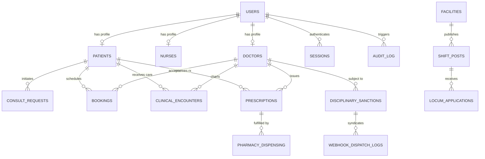

# Product Requirements Document (PRD)

## Project: MedCred / CareVerified – Verified Doctor & Nurse Network
**Version:** 3.0  
**Effective Date:** October 2026  
**Target Markets:** Malaysia (Domestic Core) & Southeast Asia (MHTC Medical Tourism)  
**System Classification:** High-Concurrency, Statutory-Compliant Digital Health & Clinical Operations Platform  
**Document Status:** Approved Architecture & Product Blueprint  

---

## 1. Executive Summary & Vision

### 1.1 Product Mission
MedCred (CareVerified) is an enterprise healthcare credentialing, telemedicine, and clinical operations network designed to establish zero-trust verification between licensed medical practitioners, healthcare institutions, patients, and pharmacies.

The platform serves two synchronized operational mandates:
1. **Domestic Malaysian Healthcare:** A regulatory-hardened healthcare operating system operating in direct compliance with the **Medical Act 1971 (Act 50)**, **Nurses Act 1950 (Act 180)**, **Private Healthcare Facilities and Services Act 1998 (Act 586)**, **Poisons Act 1952**, and **Personal Data Protection Act 2010 (PDPA)**.
2. **Global Medical Tourism:** An inbound healthcare facilitation network compliant with the **Malaysia Healthcare Travel Council (MHTC)** charter, enabling cross-border patients from ASEAN, Oceania, and the Middle East to book accredited Malaysian specialists, arrange medical visa clearances, and access verified remote second opinions.

### 1.2 Core Value Propositions
* **Zero-Trust Clinical Credentialing:** Elimination of fraudulent healthcare practice through manual and programmatic council register verification (MMC and LJM) linked to Annual Practising Certificate (APC) validity windows.
* **Statutory Telemedicine Guardrails:** Real-time policy enforcement prohibiting illegal virtual medical certificates, blocking controlled substance e-prescriptions, and mandating in-person physical triage for first-time non-communicable disease (NCD) episodes.
* **Segregation of Duties (SoD) & Four-Eyes Governance:** Institutional governance ensuring no single administrative persona possesses unchecked authority to suspend practitioners, release escrow funds, or bypass statutory audit trails.
* **Synchronized Clinical-to-Pharmacy Loop:** End-to-end digital health loop uniting patient intake, split-screen video charting (SOAP), digitally signed prescriptions, and community pharmacy dispensing.

---

## 2. Regulatory & Statutory Compliance Framework

Every architectural decision, data model, and user workflow within MedCred is governed by Malaysian statutory law and professional council ethical codes:

| Regulatory Body / Act | Statutory Scope | Platform Implementation & Guardrails |
| :--- | :--- | :--- |
| **Malaysian Medical Council (MMC)**<br>*Medical Act 1971 (Act 50)* | Physician licensing, ethical conduct, Annual Practising Certificate (APC) enforcement. | - 5-digit MMC registration verification.<br>- APC expiry tracking with automated 30-day warnings and immediate auto-suspension.<br>- Section 29 Disciplinary Inquiry workflow requiring dual-signoff countersignature. |
| **MMC Telemedicine Guidelines (2025/2026)** | Clinical ethics in virtual care, telemedicine limitations. | - **Virtual MC Ban:** UI prohibits issuing Medical Certificates solely on virtual consults; explicit statutory warning banner displayed.<br>- **Chronic Illness First-Visit Block:** First-time chronic disease visits require in-person physical assessment. |
| **Lembaga Jururawat Malaysia (LJM)**<br>*Nurses Act 1950 (Act 180)* | Nursing accreditation, State Registered Nurse (SRN) validation. | - LJM registration number validation.<br>- Verification workflow verifying nurse APC status with the Nursing Board (Ministry of Health).<br>- Section 16 board disciplinary order tracking. |
| **Ministry of Health Malaysia (MOH)**<br>*Private Healthcare Facilities Act 1998 (Act 586)* | Private clinic & hospital operating standards, staffing ratios, locum doctor deployment. | - Facility licensing registration (Form B/Form F).<br>- Locum staffing timesheets with verified practitioner matching.<br>- Outbound EHR syndication webhooks (Pantai, KPJ, Gleneagles). |
| **Pharmacy Board of Malaysia**<br>*Poisons Act 1952 / Dangerous Drugs Act 1952* | Controlled drug scheduling, prescription legality, pharmacy dispensing. | - Group B and Group C poisons e-prescribing validation.<br>- Strict prohibition on e-prescribing controlled psychotropics and dangerous drugs.<br>- Dispensing QR codes & tamper-evident verification. |
| **Department of Personal Data Protection (JPDP)**<br>*PDPA 2010 (Act 709)* | Health data sovereignty, patient consent, international data transfer. | - Explicit, bilingual (English & BM) versioned consent logging.<br>- Section 129 transfer register for cross-border patient processing.<br>- Query-level enforcement of statutory 30-day clinical record grants.<br>- 72-hour regulatory breach register. |
| **Lembaga Hasil Dalam Negeri (LHDN)** / **Royal Malaysian Customs** | Digital service taxation, withholding tax, SST compliance. | - 8% SST calculation on platform transaction fees.<br>- Locum doctor tax remittance schedules and escrow financial accounting. |
| **Malaysia Healthcare Travel Council (MHTC)** | Cross-border patient intake, international concierge medicine. | - Multi-currency display (USD, SGD, IDR, AUD, MYR).<br>- Medical concierge dossier export, interpreter preference selection, medical tourism packages. |

---

## 3. User Personas & Role-Based Access Control (RBAC)

The system establishes five primary operational personas alongside granular administrative sub-roles:

```
                                  ┌──────────────────────────────┐
                                  │      MedCred Ecosystem       │
                                  └──────────────┬───────────────┘
                                                 │
         ┌──────────────────┬────────────────────┼───────────────────┬──────────────────┐
         │                  │                    │                   │                  │
         ▼                  ▼                    ▼                   ▼                  ▼
  ┌──────────────┐   ┌──────────────┐    ┌───────────────┐   ┌──────────────┐   ┌──────────────┐
  │   Patient    │   │ Practitioner │    │   Pharmacy    │   │   Facility   │   │  Regulatory  │
  │  (Domestic & │   │  (Doctor or  │    │ (Dispensary & │   │  (Hospital/  │   │  Admin Board │
  │   Tourism)   │   │    Nurse)    │    │  Pharmacist)  │   │   Clinic)    │   │ (Governance) │
  └──────────────┘   └──────────────┘    └───────────────┘   └──────────────┘   └───────┬──────┘
                                                                                        │
                                               ┌────────────────────┬───────────────────┼───────────────────┐
                                               ▼                    ▼                   ▼                   ▼
                                       ┌──────────────┐     ┌──────────────┐    ┌──────────────┐    ┌──────────────┐
                                       │ Super-Admin  │     │   Medical    │    │   Finance    │    │   Hospital   │
                                       │ (Executive   │     │  Registrar   │    │  Controller  │    │   Staffing   │
                                       │  Registrar)  │     │ (Licensing)  │    │  (Ops/Escrow)│    │ (Facilities) │
                                       └──────────────┘     └──────────────┘    └──────────────┘    └──────────────┘
```

### 3.1 Patient (`role = 'patient'`)
* **Identity:** Malaysian citizens identified via 12-digit **MyKad (NRIC)** with automated birth date, age, place of birth, and gender derivation; foreign patients authenticated via Passport Number.
* **Capabilities:** AI symptom triage, on-demand teleconsultation queueing, scheduled virtual/in-clinic bookings, personal EHR health vault (lab results, prescription history), medical tourism package inquiries, SOS emergency dispatch.

### 3.2 Medical Practitioner (`role = 'practitioner'`)
* **Sub-Types:** Registered Medical Doctor (`role = 'doctor'`), Registered Clinical Nurse (`role = 'nurse'`).
* **Verification State:** Unverified -> Pending Board Review -> Verified (Public) / Suspended.
* **Capabilities:** Live teleconsultation on-call toggle, WebRTC video/audio consult room with split-screen HUD, SOAP clinical encounter charting, digital e-prescribing, locum hospital shift applications, financial escrow earnings ledger.

### 3.3 Community Pharmacy (`role = 'pharmacy'`)
* **Identity:** Licensed Malaysian retail/outpatient pharmacy registered under the Registration of Pharmacists Act 1951.
* **Capabilities:** Real-time digital prescription inbox, batch verification via secure token/QR, dispensing execution, delivery courier integration, patient collection tracking.

### 3.4 Healthcare Facility (`role = 'facility'`)
* **Identity:** Private hospital, ambulatory care centre, or specialist clinic licensed under Act 586.
* **Capabilities:** Locum doctor and nurse shift posting, roster scheduling, credential compliance verification, clinical shift timesheet approvals, automated payroll escrow release.

### 3.5 Regulatory & Governance Administrators (`role = 'admin'`)
To ensure compliance with institutional Segregation of Duties (SoD), administrators operate under statutory sub-roles:
* **Council Medical Registrar (`registrar`):** Primary mandate for credential verification, MMC/LJM register auditing, and initiating disciplinary sanction inquiries under Act 50 / Act 180.
* **Chief Financial Controller (`finance`):** Fiscal oversight of teleconsultation escrow releases, locum doctor wages, SST tax remittance, and refund resolutions.
* **Hospital Relations & Staffing Lead (`facilities`):** Act 586 facility licensing verification, hospital bed capacity audits, and clinical staffing shift quotas.
* **Medical Tourism & Evidence Director (`growth`):** MHTC cross-border patient concierge, international medical quotation moderation, PubMed literature curation.
* **Executive Board Registrar (`super_admin`):** Plenary statutory authority across all workspaces. Elevation to this persona invokes the **Break-Glass Ephemeral Lease Protocol (15-Minute Expiry)** with automated reversion.

---

## 4. System Architecture & Technical Specifications

```
┌────────────────────────────────────────────────────────────────────────────────────────┐
│                                   CLIENT LAYER                                         │
│  React 19 SPA · Tailwind CSS v4 · Motion · Lucide Icons · Zero-Border-Radius UI Token │
└───────────────────────────────────────────┬────────────────────────────────────────────┘
                                            │ HTTPS / WebRTC Signaling / SSE
┌───────────────────────────────────────────▼────────────────────────────────────────────┐
│                             FULL-STACK APPLICATION SERVER                              │
│  Node.js (v22+) · Express 4.x · TypeScript Engine (tsx/esbuild)                       │
│                                                                                        │
│  ┌────────────────────────┬─────────────────────────┬───────────────────────────────┐  │
│  │    Auth & Sessions     │  Clinical & Telehealth  │   Verification & Governance   │  │
│  │  - Scrypt Hashes       │  - WebRTC P2P Mesh      │   - MMC/LJM Register Rules    │  │
│  │  - HttpOnly Cookies    │  - SOAP Engine          │   - Four-Eyes Disciplinary    │  │
│  │  - 15m Lockout Logic   │  - Poisons Act Safety   │   - 15m Ephemeral Lease       │  │
│  └────────────────────────┴─────────────────────────┴───────────────────────────────┘  │
│  ┌────────────────────────┬─────────────────────────┬───────────────────────────────┐  │
│  │   Pharmacy & Escrow    │    Hospital Webhooks    │   Data Residency & Privacy    │  │
│  │  - Digital Rx Inbox    │  - HMAC SHA-256 Auth    │   - PDPA 2010 Consent Vault   │  │
│  │  - 8% SST Calculator   │  - Pantai / KPJ / Glen. │   - 30-Day Record Ceiling     │  │
│  │  - Locum Payout Ledger │  - Exponential Backoff  │   - 72h Breach Register       │  │
│  └────────────────────────┴─────────────────────────┴───────────────────────────────┘  │
└───────────────────────────────────────────┬────────────────────────────────────────────┘
                                            │ SQLite WAL (node:sqlite DatabaseSync)
┌───────────────────────────────────────────▼────────────────────────────────────────────┐
│                                   PERSISTENCE LAYER                                    │
│  SQLite 3 (PRAGMA journal_mode = WAL) · Local Document Storage · In-Memory Caches      │
│  [users, sessions, clinical_encounters, disciplinary_sanctions, hospital_webhooks, ...]│
└────────────────────────────────────────────────────────────────────────────────────────┘
```

### 4.1 Technology Stack
* **Frontend:** React 19, TypeScript, Tailwind CSS v4, Motion (`motion/react`), Lucide React.
* **Design Philosophy:** Strict high-density, zero-border-radius design tokens (`rounded-none`), high-contrast accessible typography, WCAG 2.1/2.2 AA compliant focus rings and aria attributes.
* **Backend Server:** Node.js v22+ utilizing Express 4.x bundled via `tsx` (development) and `esbuild` (production CJS).
* **Database Engine:** Native Node.js `node:sqlite` (`DatabaseSync`) configured with Write-Ahead Logging (`PRAGMA journal_mode = WAL;`) and enforced referential integrity (`PRAGMA foreign_keys = ON;`).
* **Media & Real-Time Engine:** WebRTC Mesh utilizing Google STUN infrastructure with automated TURN failover routing for enterprise hospital firewalls.

---

## 5. Granular Module Specifications

### 5.1 Credential Verification & Accreditation Engine
* **Statutory Check Flow:**
  1. Practitioner submits full name, council type (MMC or LJM), registration number, APC expiry date, specialization, and qualification certificates.
  2. The system validates registration number formats (`DEMO-MMC-XXXXX`, `DEMO-LJM-XXXXX`).
  3. Medical Council Registrars audit uploaded PDF/image credentials, perform manual verification checks against the official council register, and record statutory references.
  4. Upon approval, profile status changes to `Verified ✅` with an auto-calculated 12-month re-verification deadline (`verifiedUntil = +12 months`).
* **Automated Expiry & Auto-Suspension Daemon:**
  * Background interval evaluates active credentials against the current date.
  * If `licenseExpiry <= today` OR `verifiedUntil <= today`, practitioner status is automatically updated to `Suspended`, the public listing is delisted, and an immediate notification is dispatched.
  * 30-day early warning notifications are sent prior to expiry.

### 5.2 Teleconsultation & Live Consultation Suite
* **Patient Intake & Queue Telemetry:**
  * Patients entering `/consult` complete an intake assessment verifying:
    1. First visit vs. return visit.
    2. Acute condition vs. chronic non-communicable disease (NCD).
    3. Location (within Malaysia vs. international).
  * System blocks virtual consultations for first-time chronic disease visits, directing patients to in-person clinic appointments per MMC clinical guidance.
* **WebRTC Live Consult Room (`ConsultRoom.tsx`):**
  * P2P encrypted audio/video channel.
  * High-visibility mute, video disable, and device selection controls equipped with `aria-pressed` states.
  * **Clinician Split-Screen Heads-Up Display (HUD):**
    * Left pane: Live WebRTC video and vital signs telemetry.
    * Right pane: Real-time clinical charting workspace allowing simultaneous note-taking, e-prescribing, and patient EHR review without leaving the call.
* **Virtual Medical Certificate (MC) Policy Guard:**
  * Under MMC guidelines, virtual consultations cannot issue statutory Medical Certificates.
  * The system displays an explicit statutory banner: *"Under MMC Ethical Guidelines, medical certificates cannot be issued for virtual teleconsultations alone. If the patient requires medical leave, refer them for an in-person physical assessment."*
  * The issuance button is hard-disabled (`disabled={true}`) for virtual consultation sessions.

### 5.3 Clinical Charting, SOAP Encounters & E-Prescribing
* **Clinical Documentation (`ClinicalWorkspace.tsx`):**
  * Structured SOAP notes: **S**ubjective (Chief Complaint), **O**bjective (Vitals & Physical Findings), **A**ssessment (ICD-10 Diagnostic Impression), **P**lan (Clinical Interventions).
  * Discharge summary generation for tertiary care handoffs.
* **E-Prescribing & Poisons Act Safety Guardrails:**
  * Built-in classification checks against Malaysian Poisons Act schedules.
  * Controlled psychotropic substances (morphine, pethidine, high-potency benzodiazepines) are strictly prohibited from e-prescriptions.
  * Cross-border prescribing checks: Patients located outside Malaysia cannot be issued an e-prescription unless explicit cross-border dispensing agreements are enabled.
* **30-Day Statutory Record Grant Ceiling:**
  * Temporary access grants provided to consulting clinicians automatically expire after 30 days.
  * Enforced at the SQL query level: `WHERE expires_at > datetime('now')`.

### 5.4 Community Pharmacy Fulfillment Loop
* **Pharmacy Operations (`PharmacyWorkspace.tsx`):**
  * Dispensing Queue: Real-time list of verified digital prescriptions assigned by patient preference or geographical proximity.
  * Verification: Unique prescription reference hash and QR code validation.
  * Action Workflows: In-stock review, pharmacist clinical sign-off, patient collection notification, or third-party courier dispatch.

### 5.5 Institutional Hospital Staffing & Locum Shifts
* **Hospital Hub (`FacilityWorkspace.tsx`):**
  * Act 586 compliant facility profiles.
  * Ward & Clinical Shift Postings: Emergency Medicine, ICU, General Ward, On-Call Locum Physician shifts.
  * Automated Credential Matching: Facilities cannot accept locum applications from practitioners without verified MMC/LJM registration and active APCs.
  * Timesheet & Escrow Payout: Clock-in/clock-out verification, automated calculation of total shift wages, and release from escrow.

### 5.6 Governance, Segregation of Duties (SoD) & Audit Trails
* **Dual-Signoff Disciplinary Orders (Medical Act 1971 Section 29):**
  * Initiation of formal practitioner suspension creates a `pending_countersign` inquiry record.
  * Four-Eyes Principle: The initiating registrar cannot countersign their own order. A second authorized officer or `super_admin` must countersign to enforce formal suspension.
  * Outbound Webhook Syndication: Suspension triggers immediate HMAC-authenticated notifications to partner hospital HR systems (Pantai, KPJ, Gleneagles).
* **Break-Glass Ephemeral Lease Protocol:**
  * When an officer elevates to `super_admin` or an elevated persona, an emergency case reference and statutory justification must be logged.
  * A strict 15-minute lease timer (`cv_admin_elevation_lease_until`) activates.
  * A live countdown badge (`Lease: MM:SS`) is displayed in the header.
  * Upon expiry, the system automatically revokes elevated permissions and downgrades the persona back to standard `Council Medical Registrar` (`registrar`).
* **Outbound Hospital EHR Webhooks:**
  * Outgoing webhooks attach:
    * `X-MedCred-Signature-256`: SHA-256 HMAC digest of payload.
    * `X-MedCred-Timestamp`: Unix epoch timestamp to prevent replay attacks.
    * `X-MedCred-Delivery-Id`: Unique delivery UUID mapped to the SQLite WAL dispatch log.
    * `X-MedCred-Delivery-Attempt`: Retry counter with exponential backoff (60s -> 300s -> 1800s).
* **Statutory Audit Trail (`AdminAuditLog.tsx`):**
  * Immutable event logging capturing timestamp, actor ID, actor role, IP address, target entity, and complete JSON mutation diffs.

---

## 6. Data Models & Entity-Relationship Schema

The SQLite persistence layer is structured around verified clinical relationships:



### 6.1 Database Tables Overview
* `users`: Authentication records, role, email, password hash (scrypt), failed login counters, locked_until timestamp.
* `sessions`: Server-side session tokens, SHA-256 token hashes, creation and expiration timestamps.
* `verification_requests`: Credential review submissions, document attachments, council register check notes, decision timestamps.
* `verification_events`: Immutable history of practitioner verification milestones.
* `disciplinary_sanctions`: Disciplinary inquiries, statutory basis (Act 50 s.29 / Act 180 s.16), initiator details, countersigner details, reference numbers, enforcement status.
* `hospital_webhooks`: External partner hospital endpoints, active event subscriptions, shared secret keys.
* `webhook_dispatch_logs`: WAL log of outgoing webhooks, response status codes, delivery attempts, and retry timestamps.
* `clinical_encounters`: Completed consultation records, SOAP notes, vital signs telemetry, diagnostic impressions.
* `prescriptions`: Digital medication orders, Poisons Act schedule tags, dosage instructions, dispensing statuses.
* `bookings`: Scheduled video and in-clinic consultation slots, payment status, meeting tokens.
* `audit_log`: Append-only compliance log capturing all administrative and clinical mutations.

---

## 7. Security, Privacy & Data Protection (PDPA)

### 7.1 Authentication & Session Hardening
* Password Storage: Derived using **scrypt** with cryptographically secure random 16-byte salts (N=16384, r=8, p=1).
* Account Lockout: Enforces 15-minute account lockouts following 5 consecutive failed authentication attempts.
* Session Cookies: Strict `HttpOnly`, `SameSite=Lax`, and `Secure` (production) cookie parameters preventing cross-site scripting (XSS) session theft.

### 7.2 PDPA 2010 Compliance & Data Sovereignty
* **Bilingual Consent Records:** Versioned privacy policy consents recorded with exact timestamps and consent versions.
* **Data Residency:** Configurable data directory (`DATA_DIR`) defaulting to Malaysian local server storage. Outbound cross-border data transfers are catalogued in the Section 129 transfer register.
* **Data Subject Rights:** Full programmatic support for user data export (`GET /api/me/export`) and irreversible account deletion/de-identification (`POST /api/me/deletion-request`).
* **Breach Response Register:** 72-hour Commissioner reporting countdown and notification tracking for suspected security incidents.

---

## 8. Non-Functional Requirements & Performance SLAs

| Metric / Dimension | Specification Target | Verification Mechanism |
| :--- | :--- | :--- |
| **API Response Latency** | < 150ms (p95) for clinical queries | Express middleware telemetry & SQLite indexed queries. |
| **WebRTC Media Latency** | < 80ms round-trip for domestic calls | Direct P2P mesh connection with STUN/TURN fallback. |
| **Turnaround SLA** | < 24 hours for credential approval | Real-time SLA tracker widget on Admin Dashboard. |
| **Build & Compilation Time**| < 15 seconds full-bundle build | Vite v6 + esbuild production pipeline (`npm run build`). |
| **Availability Target** | 99.9% uptime during operational hours | Stateless application tier with WAL-mode persistence. |
| **Accessibility Standard** | WCAG 2.1 / 2.2 Level AA | High-contrast text tokens, semantic button landmarks, aria-pressed states. |

---

## 9. Phased Delivery & Engineering Roadmap

### Phase 1: Core Credentialing & Domestic Telemedicine (Completed)
- [x] Malaysian Medical Council (Act 50) and Nursing Board (Act 180) accreditation engine.
- [x] WebRTC consultation room with Split-Screen Heads-Up Charting Workspace (HUD).
- [x] MMC Teleconsultation Medical Certificate restriction enforcement.
- [x] SOAP charting, e-prescribing, and Poisons Act controlled substance guardrails.
- [x] Centralized Segregation of Duties (SoD) Dual-Signoff Inbox (`AdminDashboard.tsx`).
- [x] Break-Glass Ephemeral Lease Protocol (15-minute auto-reversion).
- [x] Outbound Hospital EHR Webhook engine with HMAC SHA-256 authentication.

### Phase 2: Pharmacy Network & Locum Shift Scaling (Current)
- [x] Community Pharmacy dispensing workspace & prescription QR validation.
- [x] Private Hospital (Act 586) locum shift marketplace and timesheet tracking.
- [ ] Direct FPX / DuitNow payment gateway integration for automated patient payments.
- [ ] Push notification service worker for instant practitioner teleconsult alarms.

### Phase 3: Regional Interoperability & Medical Tourism Expansion (Upcoming)
- [ ] HL7 FHIR R4 export adapter (`/api/fhir/R4/Encounter`) for enterprise hospital integrations.
- [ ] Multi-lingual translation pipeline (Bahasa Melayu, Mandarin, Arabic) for MHTC travelers.
- [ ] Column-level AES-256 encryption at rest for sensitive consultation transcripts.
