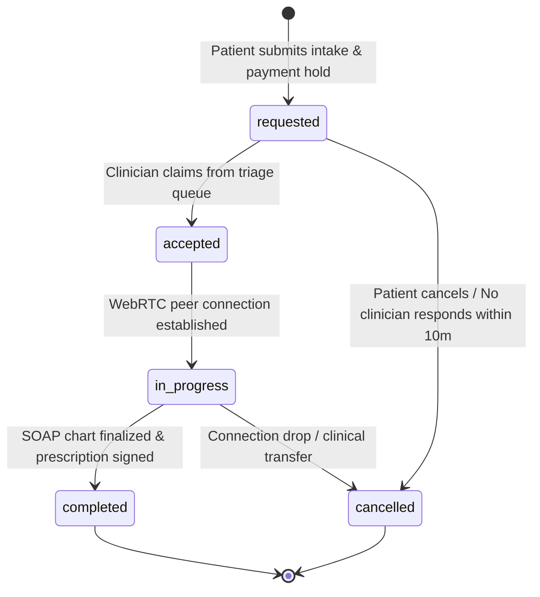

# CareVerified Unified Clinical, Architectural & Governance Rules (RULE.md)

This document establishes the **binding operational directives, clinical safety rules, security standards, coding guidelines, and regulatory enforcement protocols** governing all development, operations, integrations, and administration across the **CareVerified (MedCred)** enterprise telehealth and clinical operations ecosystem.

Every engineer, system component, autonomous agent, and operational administrator MUST strictly abide by these rules. Zero tolerance for deviations or unauthorized bypasses.

---

## 1. Statutory & Regulatory Compliance Directives

CareVerified operates at the nexus of clinical care delivery, professional licensure verification, e-prescribing, and cross-border medical travel. Compliance with statutory healthcare frameworks is mandatory.

### 1.1 Telemedicine Act 1997 & Medical Act 1971 (Malaysia)
- **R-MED-01: Valid Fully Registered Clinician Exclusivity**:
  Only fully registered medical practitioners holding a valid Annual Practicing Certificate (APC) with the Malaysian Medical Council (MMC) may consult patients, formulate diagnostic plans, or issue clinical certificates.
- **R-MED-02: Patient Identity Verification (e-KYC)**:
  Prior to establishing a teleconsultation, the patient's identity must be cryptographically attested against their statutory NRIC or International Passport number.
- **R-MED-03: Mandatory Informed Tele-Consent**:
  Before any video/audio consultation begins, an explicit, versioned tele-consent must be captured (`consent_version`, `consent_at`). Patients must be informed of the limitations of remote physical examinations and the availability of emergency escalation.
- **R-MED-04: Continuity of Care & Clinical Referrals**:
  When a patient's condition falls outside the safe purview of telemedicine (e.g. chest pain, severe dyspnea, acute neurological deficits), the practitioner MUST initiate an immediate transfer/referral (`referrals` table) or trigger the platform emergency protocol.

### 1.2 Poisons Act 1952 & Controlled Substances Governance
- **R-RX-01: Group B & C Poison E-Prescribing Standards**:
  All digital prescriptions for Group B poisons require a verified doctor's signature and registration number. Prescriptions must specify:
  1. Full patient legal name and NRIC/Passport.
  2. Prescribing doctor's statutory MMC registration number and facility address.
  3. Medication chemical/generic name, dosage form, strength, quantity, frequency, and maximum daily limit.
  4. Date of issuance and explicit expiry date (maximum 90 days validity).
- **R-RX-02: Prohibition of Dangerous Drugs (Schedule 1)**:
  Under no circumstances may Schedule 1 Dangerous Drugs (e.g. high-potency opioids, illicit psychotropics) be prescribed via digital telehealth channels without prior in-person board authorization.
- **R-RX-03: Statutory Dispensary Poisons Register**:
  Every dispensing pharmacy MUST automatically record dispensed medications into the immutable electronic `pharmacy_poisons_register` table upon patient collection or dispatch handover.
- **R-RX-04: Cold-Chain Verification for Biologicals**:
  For temperature-sensitive medications (insulin, biologics, vaccines), dispatch fulfillment (`deliveries`) requires continuous telemetry monitoring (`delivery_temperature_logs`). Any temperature excursion outside **2°C – 8°C** triggers an automated delivery hold and pharmacist quarantine.

### 1.3 Personal Data Protection Act 2010 (PDPA) & HIPAA Technical Safeguards
- **R-SEC-01: 30-Day Clinical Record Grant Ceiling**:
  Ad-hoc patient medical record access granted to external practitioners or facilities (`record_grants`) MUST NOT exceed **30 consecutive calendar days**. Indefinite or perpetual access grants are rejected at the database schema level.
- **R-SEC-02: Right to Erasure & Statutory Retention Conflicts**:
  When a user requests account deletion under PDPA (`users.deletion_requested_at`), an automated 30-day statutory cooling-off period begins. Clinical records required by healthcare record retention laws (minimum 7 years for adults, age 28 for pediatric records) are pseudonymized and transferred to cold archives; they are NEVER deleted from immutable audit logs.
- **R-SEC-03: Data Sovereignty & Cross-Border Telemetry**:
  All primary relational clinical data, patient identifiers, and session transcripts must reside within domestic data centers. Cross-border transfers for medical tourism MUST have explicit, documented patient consent (`consents` table) and a Transfer Impact Assessment (`data_processors.pdpa_basis`).

---

## 2. Segregation of Duties (SoD) & Governance Protocols

Segregation of Duties prevents clinical fraud, rogue administrative sanctions, and unvetted credential approvals.

### 2.1 Dual-Signoff for Disciplinary Actions & Revocations
- **R-SOD-01: Independent Initiator and Countersigner Requirement**:
  Any suspension, license restriction, or disciplinary sanction against a healthcare practitioner (`disciplinary_sanctions`) CANNOT be executed by a single individual:
  1. **Initiator**: An authorized Administrative Officer or Registry Auditor files the sanction specifying statutory basis, evidence references, and sanction type. State becomes `pending_countersign`.
  2. **Countersigner**: A separate Medical Board Officer or Chief Governance Administrator must independently review and countersign the action.
  3. **Constraint**: `initiator_id != countersigner_id`. The system rejects self-approval with HTTP 403 Forbidden.
- **R-SOD-02: Real-Time Dual-Signoff Inbox Notification**:
  Administrative dashboards must maintain an active real-time badge and inbox for pending countersignatures (`GET /api/admin/sanctions/pending`).

### 2.2 Break-Glass Emergency Overrides
- **R-SOD-03: Ephemeral 15-Minute Emergency Lease**:
  In critical clinical emergencies (e.g., patient in acute shock, offline attending physician), authorized clinicians or facility managers may invoke a "Break-Glass" protocol to access locked clinical charts.
- **R-SOD-04: Mandatory Audit Reason & Auto-Reversion**:
  1. The actor must submit a high-acuity clinical justification.
  2. The break-glass lease automatically expires in **15 minutes** (900 seconds).
  3. An immutable high-severity entry is dispatched to `audit_log`, and immediate webhook alerts notify the compliance officer.

### 2.3 Hospital EHR Webhook Authentication & Dispatch
- **R-SOD-05: HMAC-SHA256 Signature Headers**:
  All outbound clinical and credentialing webhook dispatches to institutional EHR systems must include:
  - `X-MedCred-Signature-256`: `sha256=HMAC_SHA256(secret_key, timestamp + "." + payload)`.
  - `X-MedCred-Timestamp`: Current Unix epoch millisecond timestamp.
  - `X-MedCred-Delivery-Id`: Unique dispatch UUID for deduplication.
- **R-SOD-06: Webhook Delivery Guarantees & Exponential Backoff**:
  Failed webhook dispatches must retry up to 5 times using exponential backoff (`1m, 5m, 15m, 1h, 6h`). Delivery state and response codes are immutably tracked in `webhook_dispatch_logs`.

---

## 3. Clinical Workflow & Consultation Safety Directives

### 3.1 Consultation Lifecycle State Machine
Consultations follow a deterministic, irreversible state progression:



- **R-CLN-01: Payment Escrow Hold Before Queueing**:
  No consultation may enter the `requested` queue without an active pre-authorization or escrow hold in the `payments` table.
- **R-CLN-02: Mandatory SOAP Clinical Charting**:
  Before an encounter can transition to `completed`, the clinician MUST complete the four SOAP pillars in the `encounters` table:
  - **S**ubjective (Patient history, chief complaint).
  - **O**bjective (Vitals, physical observations).
  - **A**ssessment (Differential diagnosis, clinical reasoning).
  - **P**lan (Therapy, prescriptions, lab investigations, referrals).
- **R-CLN-03: Post-Visit Encounters Lock**:
  Once an encounter is marked `completed`, its SOAP fields and associated `prescriptions` become cryptographically frozen. Subsequent modifications require an explicit addendum note linked to `audit_log`.

### 3.2 Real-Time Presence & Video Media Standards
- **R-CLN-04: 15-Second Heartbeat Liveness**:
  Clinicians and patients in active sessions must emit presence heartbeats every 15 seconds. If a clinician heartbeat lapses for >45 seconds, the consultation state warns both parties and alerts the triage desk.
- **R-CLN-05: WebRTC Peer-to-Peer Encryption**:
  All media streams (audio, video) must utilize DTLS-SRTP encryption with 128-bit or 256-bit AES cipher suites. Signaling packets (`consult_signals`) must be ephemeral and purged upon call termination.

---

## 4. Architectural & System Engineering Rules

### 4.1 Backend Engine & Node.js Native SQLite Standards
- **R-ENG-01: Zero-Network Embedded Database**:
  Primary storage uses Node.js 22+ native SQLite bindings (`node:sqlite` via `DatabaseSync`). External network DB latency is eliminated for sub-millisecond local reads.
- **R-ENG-02: Mandatory PRAGMA Initialization**:
  Every database connection boot MUST execute:
  ```sql
  PRAGMA journal_mode = WAL;
  PRAGMA foreign_keys = ON;
  PRAGMA synchronous = NORMAL;
  PRAGMA busy_timeout = 5000;
  ```
- **R-ENG-03: Parameterized Prepared Statements Only**:
  Raw string interpolation or concatenation in SQL statements is strictly prohibited. Every query MUST use parameterized placeholders (`?`) to guarantee zero SQL injection risk.
- **R-ENG-04: Distributed Lock Emulation**:
  Financial transactions and e-prescription countersignatures must execute inside atomic SQLite transactions (`BEGIN IMMEDIATE ... COMMIT`).

### 4.2 Security, Authentication & Session Custody
- **R-ENG-05: Argon2id/scrypt Password Digesting**:
  Plaintext passwords must never touch logs or storage. Passwords must be hashed using scrypt/Argon2id with per-user cryptographic salts.
- **R-ENG-06: Session Token Cryptographic Custody**:
  Session tokens must be generated using `crypto.randomBytes(32)`. The raw token is delivered to the client in an `HttpOnly`, `SameSite=Strict`, `Secure` cookie or Authorization bearer header. The database ONLY stores the SHA-256 hash (`sessions.token_hash`).
- **R-ENG-07: Account Brute-Force Lockouts**:
  Five (5) consecutive failed logins increment `users.failed_logins` and trigger a 15-minute account lockout (`users.locked_until`).
- **R-ENG-08: Token Revocation Epoch**:
  Changing passwords or enabling MFA updates `users.sessions_valid_after`, immediately invalidating all pre-existing sessions.

---

## 5. Frontend & UI/UX Design System Rules

CareVerified employs a high-contrast, clinical-grade interface adhering strictly to the **Rose Pine / Crisp White** design token hierarchy defined in [DESIGN.md](file:///c:/Users/Manas/.gemini/antigravity/scratch/careverified---verified-doctor---nurse-network/DESIGN.md).

### 5.1 Color Palette & Token Directives
- **R-UI-01: Strict Color Semantics**:
  - **Canvas Base**: `#F8FAFC` (Slate-50) or pure white `#FFFFFF`. Dark mode / dingy hospital grays are prohibited.
  - **Primary Brand**: Medical Rose / Crimson (`#E11D48` / `#BE185D`).
  - **Clinical Success / Verified**: Emerald (`#059669` / `#10B981`).
  - **Clinical Warning / Triage Medium**: Amber (`#D97706` / `#F59E0B`).
  - **Critical Emergency / High Acuity**: Crimson Red (`#DC2626`).
- **R-UI-02: Accessibility & WCAG 2.2 AA Conformance**:
  - All text elements must achieve a contrast ratio of at least **4.5:1** against their background (**3:1** for large 18pt+ headlines).
  - Interactive clickable targets (buttons, inputs, toggles) must meet a minimum hit dimension of **44 × 44 pixels** for motor-impaired clinicians and mobile touchscreens.
  - Interactive inputs must provide visible, non-color-only focus rings: `focus:ring-2 focus:ring-rose-500/30 focus:border-rose-500`.

### 5.2 Component & Layout Architecture
- **R-UI-03: Responsive Breakpoints**:
  All interfaces must render seamlessly across four primary viewports:
  - Mobile (320px – 639px): Single-column stack, thumb-accessible bottom actions.
  - Tablet (640px – 1023px): Collapsible secondary drawers, persistent video pip.
  - Desktop (1024px – 1439px): Multi-pane consultation layout (video on left, SOAP EHR on right).
  - Wide Enterprise (1440px+): Max container width constrained to `1440px` with centered guttering.
- **R-UI-04: Non-Blocking Real-Time Indicators**:
  Network indicators, WebRTC reconnection states, and pharmacy delivery tracking must use non-modal inline banners or toast alerts; they must never lock the clinician out of active charting.

---

## 6. Financial Clearinghouse & Locum Escrow Directives

### 6.1 Payment Capture & Platform Commissions
- **R-FIN-01: Clear Itemized Billing**:
  Every consultation fee (`consults.fee_myr`) and locum shift fee (`job_applications.shift_wage_myr`) must clearly differentiate:
  1. Clinician Professional Fee / Shift Wage.
  2. Platform Service & Infrastructure Fee.
  3. Statutory Service Tax (SST 8% where applicable).
- **R-FIN-02: Escrow Lock & Release Protocol**:
  1. **Lock**: Shift wages are held in escrow immediately upon hospital contract acceptance.
  2. **Clock-in Verification**: Clinician checks in via GPS / facility QR.
  3. **Release**: Funds are released to `payouts` only after the facility director certifies shift completion or 48 hours lapse without a dispute.

### 6.2 Practitioner Payout Batches
- **R-FIN-03: Verified Bank Account Prerequisite**:
  Clinician payouts (`payouts`) CANNOT be batched or executed unless the clinician's `payout_accounts.is_verified = 1` and matches their statutory tax name.
- **R-FIN-04: Batch Idempotency & Audit**:
  Every payout execution must be grouped in a unique `payout_batches` record with an aggregate total hash to prevent duplicate bank disbursements.

---

## 7. Operational & Code Hygiene Rules

### 7.1 Development & Build Integrity
- **R-DEV-01: Zero TypeScript Compilation Errors**:
  Code submitted to the repository must pass `npm run build` cleanly with zero TypeScript (`tsc`) diagnostics or syntax warnings.
- **R-DEV-02: Documentation Parity**:
  Any change to database tables, API routes, or design tokens must be immediately synchronized with:
  - `PRD.md` (Product specifications).
  - `ARCHITECTURE.md` (System boundaries and flowcharts).
  - `DESIGN.md` (Design tokens and UI components).
  - `DATABASE.md` (DDL, indexing, and statutory retention).
  - `RULE.md` (Governance and compliance rules).

### 7.2 Git & Version Control Protocol
- **R-DEV-03: Atomic Descriptive Commits**:
  Commits must follow Conventional Commits formatting:
  - `feat:` New user-facing or backend functionality.
  - `fix:` Bug or vulnerability remediations.
  - `docs:` Architectural, PRD, or database documentation.
  - `refactor:` Code refactoring without behavioral alterations.
- **R-DEV-04: Verified Branch Synchrony**:
  All production changes must be rebased and pushed cleanly to `origin/main` with working directory tree cleanliness verified.

---

## 8. Incident Management & Regulatory Reporting Matrix

| Severity | Incident Type | SLA / Response Window | Regulatory Notification Mandate |
| :--- | :--- | :--- | :--- |
| **P1 - Critical** | PHI Data Breach / Unauthorized Exfiltration | **< 1 Hour** triage | Personal Data Protection Commissioner (Malaysia) notified within **72 hours** under PDPA guidelines. |
| **P1 - Critical** | Unvetted Clinician Impersonation / Fake APC | **Immediate** revocation | Malaysian Medical Council (MMC) & Ministry of Health (MOH) incident filing. |
| **P2 - High** | Dual-Signoff SoD Bypass Attempt | **< 4 Hours** investigation | Internal Audit & Governance Board immediate review. |
| **P2 - High** | Cold-Chain Biologicals Temperature Excursion | **< 2 Hours** hold | Pharmacy Enforcement Division compliance note; batch quarantine. |
| **P3 - Medium** | WebRTC Media Signaling Interruption | **< 8 Hours** remediation | Client notification with fallback audio dial-in. |
| **P4 - Low** | Minor UI Rendering Glitch / Responsive Defect | **Next Sprint Cycle** | Logged via GitHub Issues; resolved in routine release. |

---

*Directives promulgated and ratified by the CareVerified Executive Leadership Board, Chief Medical Officer, and Principal Systems Architect.*
